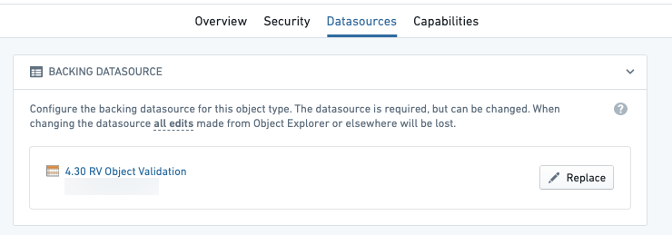
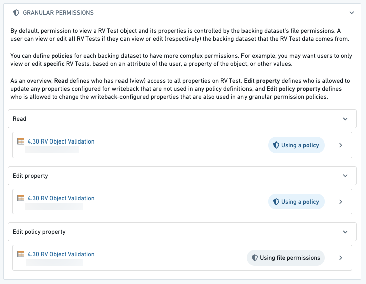

:::callout{theme="warning"}
注意：以下翻译的准确性尚未经过验证。这是使用 [AIP ↗](https://www.palantir.com/platforms/aip/) 从原始英文文本进行的机器翻译。
:::

# 配置受限视图支持的对象类型

[受限视图 (RVs)](https://www.palantir.com/docs/foundry/platform-security-management/manage-restricted-views/#use-restricted-views-to-back-object-types) 以实现Ontology数据的行级访问控制。这允许比简单地授予对整个数据集或某一类型的所有对象的访问更精细的访问控制。

受限视图类似于数据集，但限制对数据集中*特定行*的访问。受限视图在数据集级别配置，Ontology对象继承受限视图策略中定义的细粒度权限。

## 使用受限视图支持对象类型

使用受限视图支持对象类型将控制用户可以看到的特定对象。例如，如果用户满足某个策略的要求并可以看到受限视图中的特定行，那么他们将能够看到相应的Ontology对象，即使没有访问受限视图资源本身的权限。

要查看由数据集支持的对象类型的对象，您还必须能够查看该数据集。

* 在Object Storage v1 (Phonograph)中，要查看由受限视图支持的对象类型的对象，您必须能够查看对象类型本身；不一定需要查看受限视图。而是只需满足受限视图的[权限标记](https://www.palantir.com/docs/foundry/security/restricted-views/#create-marking-backed-restricted-views)及其对该行的读取策略。
* 在Object Storage v2中，您必须能够查看受限视图才能查看由该受限视图支持的对象类型的对象。

当限制用户的特定对象时，只选择Ontology管理器中的受限视图作为对象类型的支持数据源。

## 安全配置

Ontology管理器中的**数据源**选项卡将显示用于编辑**细粒度策略**的附加配置选项。**细粒度策略**部分允许您配置编辑此类型对象的权限。

:::callout{theme="warning"}
编辑的细粒度策略只能为使用Object Storage v1且未选择**仅允许通过操作编辑**选项的对象类型配置。对于所有其他对象类型，编辑权限通过操作类型编辑对象类型来控制。[了解更多关于操作权限的信息。](../../%E5%AE%9A%E4%B9%89%E6%9C%AC%E4%BD%93/%E5%8A%A8%E4%BD%9C%E7%B1%BB%E5%9E%8B/%E6%9D%83%E9%99%90.md)
:::

您可以配置这些策略以适应您希望用户仅根据其属性（如对象的属性）查看或编辑特定对象的情况。例如，您可能只希望来自`Europe`（在`region`列中找到）的用户查看和编辑欧洲对象，这可能与受限视图的策略不同。

有三种策略可以定义谁可以访问对象上的属性：

* **读取：** 此策略定义谁可以查看受限视图上的所有属性。使用上面的例子，这可能是一个将`region`列与用户属性中的内容（`Europe`）进行比较的策略，以确定用户可以看到哪些对象。
* **编辑属性：** 此策略定义谁可以更新配置为数据输出的任何属性，而这些属性未用于任何细粒度权限策略定义。使用上面的例子，此策略将控制谁可以编辑`name`属性，但不控制谁可以编辑`region`属性，因为`region`属性用于策略中。
* **编辑策略属性：** 此策略定义谁可以更新配置为数据输出的任何属性，同时这些属性也用于任何细粒度权限策略定义。使用上面的例子，此策略将控制谁可以编辑`region`属性。

:::callout{theme="warning"}
如果在对象类型使用Object Storage v1 (Phonograph)注册后更改了查看策略，则必须通过**Ontology管理器**中对象类型**数据源**选项卡的Phonograph部分中的**更新**按钮更新注册。如果未更新注册，则可能会根据先前注册的策略提供受限视图的最新数据。在Object Storage v2中，默认情况下提供自动策略传播。
:::
