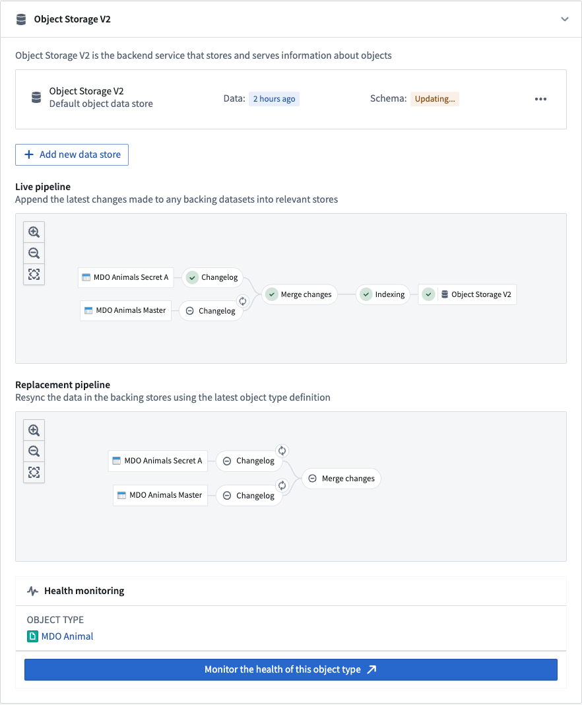
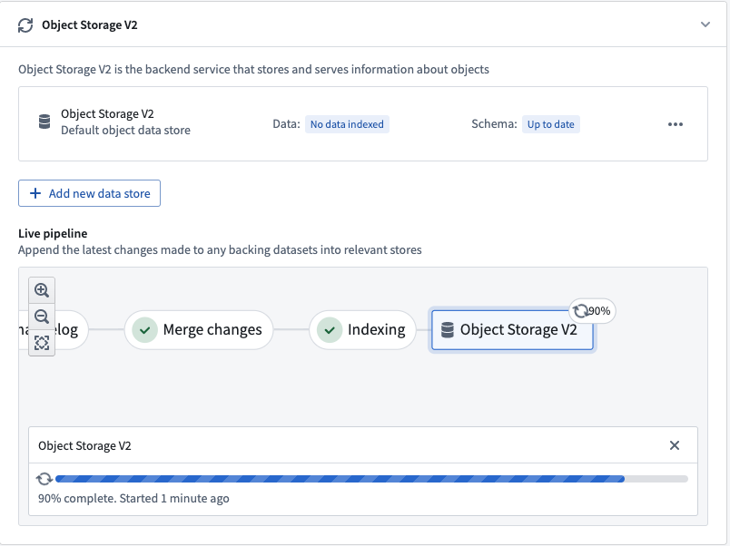
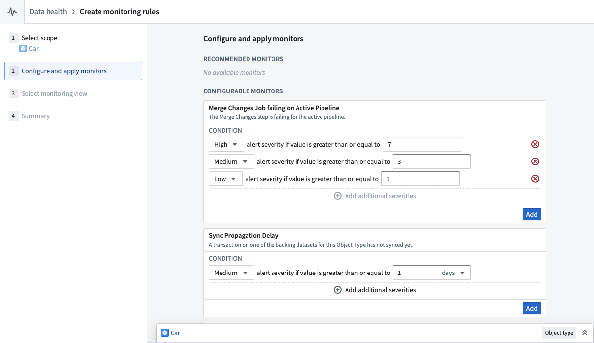
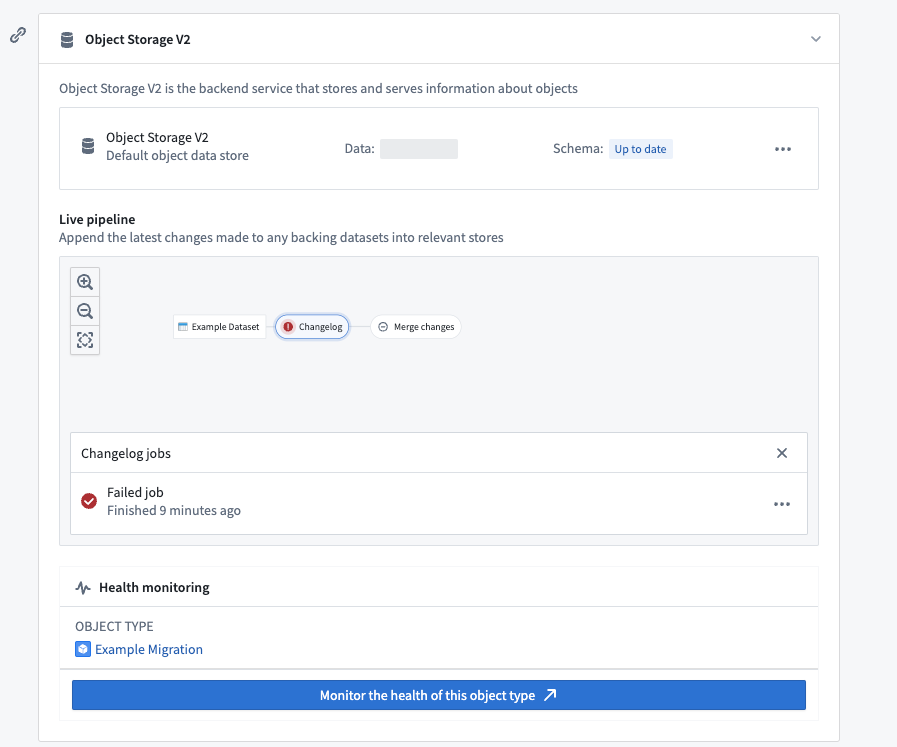
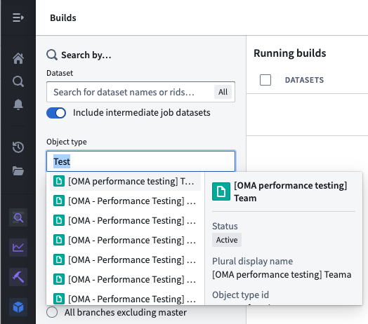

:::callout{theme="warning"}
注意：以下翻译的准确性尚未经过验证。这是使用 [AIP ↗](https://www.palantir.com/platforms/aip/) 从原始英文文本进行的机器翻译。
:::

# Funnel批处理管道

Funnel批处理管道是内部任务管道，负责将数据（来自Foundry数据源和用户编辑）以批处理方式高效地索引到OSv2中，以确保Ontology中的数据和元数据是最新的。

## Funnel批处理管道的组成部分

一个Funnel批处理管道由一系列[Foundry搭建任务](https://www.palantir.com/docs/foundry/data-integration/datasets/)组成：

* [更改记录](#changelog)
* [合并更改](#merge-changes)
* [索引](#indexing)
* [数据灌注](#hydration)

下面的截图展示了一个示例Funnel批处理管道。



### 更改记录

在更改记录任务中，当数据源接收到新数据或交易时，Funnel会自动计算所有数据源的数据差异，然后在Funnel管道中创建中间更改记录数据集。更改记录数据集接收包含每个交易中的数据差异的[追加交易](https://www.palantir.com/docs/foundry/data-integration/datasets/#transaction-types)，以提供[增量计算语义](https://www.palantir.com/docs/foundry/data-integration/datasets/#transaction-types)。这些更改记录数据集由Funnel拥有和控制，因此用户无法访问。

### 合并更改

在合并更改任务中，来自更改记录步骤的所有更改记录数据集和来自操作的任何最近用户编辑，都会通过对象类型的主键合并所有更改并存储在一个单独的数据集中。这些合并的数据集由Funnel拥有和控制，因此用户无法访问。

### 索引

在更改合并后，Funnel为每个对象数据库启动一个索引任务，将最终数据集中所有合并的更改转换为与为对象类型配置的对象数据库兼容的格式。例如，对于标准OSv2数据库，来自上一步的合并更改数据集中的所有行都会被转换为索引文件；这些文件存储在一个单独的索引数据集中。这些索引数据集由Funnel拥有和控制，因此用户无法访问。

### 数据灌注

一旦索引任务完成，对象数据库必须准备索引数据以便查询。以OSv2为例，这个准备步骤涉及将索引文件从数据集中下载到OSv2数据库搜索节点的磁盘上。这个过程被称为*数据灌注*，是我们示例Funnel批处理管道更新对象类型数据的最后一步。

数据灌注任务的进度在Ontology管理器应用中报告，如下图所示。



一旦这些步骤完成，对象类型即可使用，并可以被其他服务在外部或Foundry中查询。

## 实时和替换Funnel管道

当对象类型有数据更新或架构更新时，会涉及两个单独的Funnel管道。下面的截图展示了这两个Funnel管道：


### 实时管道

Funnel*实时管道*在生产中使用Foundry数据源中的新数据更新对象类型。实时管道在各自的数据源更新时运行。此外，如果检测到对象上的用户编辑，实时管道将每六小时运行一次，无论是否有明确的支持数据集更新；这确保了用户编辑在索引到Funnel拥有的数据集的合并更改步骤中被持久化。

请注意，用户编辑会立即应用于[对象数据库](../%E5%AF%B9%E8%B1%A1%E5%90%8E%E7%AB%AF/%E6%A6%82%E8%BF%B0.md#functional-components-and-architecture)中的索引；一个常规的六小时任务间隔提供了一个内置的控制机制，以便在Foundry中持久存储这些数据。

### 替换管道

当对象类型的架构更改且之前管道的架构不再是最新的时，必须提供一个新的*替换管道*来协调对象类型更新。架构更改可以包括为对象类型添加新属性类型、更改现有属性类型或用另一个数据源替换对象类型的输入数据源。

虽然实时管道继续按其通常的节奏运行，但Funnel将在后台组织一个替换管道，而不影响提供给用户的实时数据。在替换管道第一次成功运行后，实时管道将被废弃并由替换管道替代；对象类型的架构和数据将相应更新。

## 增量和全量重新索引

:::callout{theme="neutral"}
以下文档特定于标准Object Storage v2数据存储。有关Object Storage v1 (Phonograph)的索引行为信息，请参阅[OSv1文档](../%E5%AF%B9%E8%B1%A1%E6%95%B0%E6%8D%AE%E5%BA%93/%5B%E9%81%97%E7%95%99%5D%20Object%20Storage%20v1%20%28Phonograph%29.md#incremental-and-batch-reindexing)。
:::

### 增量索引（默认）

标准Object Storage v2数据存储自动计算数据源中每个新交易的数据差异，并仅对新数据更新进行增量索引。Funnel管道默认对所有对象类型使用增量索引。增量索引允许Funnel管道比所有数据都需要重新索引时运行得更快。

例如，假设您有一个对象类型包含100个对象实例，由一个100行的数据源支持。如果在新的数据更新中有10行更改，而不是无视输入数据源中的[交易类型](https://www.palantir.com/docs/foundry/data-integration/datasets/#transaction-types)重新索引所有100个对象实例，[Funnel批处理管道](Funnel%E6%89%B9%E5%A4%84%E7%90%86%E7%AE%A1%E9%81%93.md)将在更改记录数据集中创建一个新的`追加`交易，其中仅包含10个修改过的行。

#### 增量数据集的增量索引

[Object Storage v2](../%E5%AF%B9%E8%B1%A1%E5%90%8E%E7%AB%AF/%E6%A6%82%E8%BF%B0.md#object-storage-v2-architecture)在同步由增量数据集支持的对象类型时使用“最新交易胜出”策略。如果数据集中同一个主键的多行，最新交易中的行数据将在Ontology中可见。您不能在单个交易中有重复的主键。请注意，这种行为与如何处理[用户编辑和数据源更新冲突](../%E5%AF%B9%E8%B1%A1%E7%BC%96%E8%BE%91/%E7%94%A8%E6%88%B7%E7%BC%96%E8%BE%91%E7%9A%84%E5%BA%94%E7%94%A8%E6%96%B9%E5%BC%8F.md#resolve-conflicting-user-edits-and-datasource-updates)无关。

考虑一个通过`追加`交易接收行更新的增量数据集，通常称为更改记录数据集。同一数据的新版本由一个具有更新值但相同主键的新行表示，追加到一个交易中的数据集中。更改记录数据集可能还有一个类型为Boolean的`is_deleted`列。当`is_deleted`列的值为true时，该行应被视为已删除。

Object Storage v2同步更改记录数据集如下：

* 如果一个主键出现在多个交易中，将保留最新交易中的行。
* 每个交易最多包含每个主键一行。
* 如果您的数据集是一个Object Storage v1更改记录，Object Storage v2将尊重`is_deleted`列，但不尊重排序列。

您可能需要对更改记录数据集执行增量窗口变换，以确保每个交易最多包含每个主键一行。

```python
from pyspark.sql.window import Window
from pyspark.sql import functions as F

# 定义一个窗口函数，按照 'primary_key' 分区，并根据 'ordering' 列降序排列
ordering_window = Window().partitionBy('primary_key').orderBy(F.col('ordering').desc())

# 使用窗口函数为每个分区添加 'rank' 列，值为当前行的行号
df = df.withColumn('rank', F.row_number().over(ordering_window))

# 过滤数据，只保留 'rank' 为 1 且 'is_deleted' 为 False 的行
df = df.filter((F.col('rank') == 1) & ~F.col('is_deleted'))
```

### 全量重新索引（特殊情况）

Funnel 管道将在两种情况下使用批量索引（其中所有 Object 实例都会重新索引）：

* 当输入数据源中的行有超过一定百分比在同一事务中被修改时，重新索引比计算更改日志并增量索引在计算上更便宜且更快。默认阈值设置为同一事务中更改的行数达到 80%。
* Object 类型模式的某些更改需要[Funnel 替换管道](Funnel%E6%89%B9%E5%A4%84%E7%90%86%E7%AE%A1%E9%81%93.md#replacement-pipelines)，这将在后台创建一个全新的 Funnel 管道（包括 OSv2 索引）。

## 监控 Funnel 管道

Funnel 管道由多个搭建任务组成；[监控视图](https://www.palantir.com/docs/foundry/maintaining-pipelines/monitoring-views-intro/#monitoring-at-scale)通过创建一组[监控规则](https://www.palantir.com/docs/foundry/maintaining-pipelines/monitoring-views-intro/#create-monitoring-rules)使用户能够跟踪 Funnel 管道中特定任务的健康状况。

用户可以通过在 Ontology 管理器中选择**监控此 Object 类型的健康状况**来创建监控视图。这将带用户进入数据健康应用程序的[监控视图](https://www.palantir.com/docs/foundry/maintaining-pipelines/monitoring-views-intro/)选项卡，如下图所示。



在监控视图选项卡中，用户可以为监控实时管道和替换管道中的任务创建规则。用户还可以添加**同步传播延迟**规则，以便在 Object 数据库中索引数据的新鲜度超过规则中定义的阈值时收到通知。

相比之下，Object 存储 V1（Phonograph）使用[健康检查](https://www.palantir.com/docs/foundry/maintaining-pipelines/recommended-health-checks/#optional-checks)来监控 Ontology 实体的同步；在 OSv1 中，对于 Object 类型只有一个同步任务，用户可以直接在同步任务上定义这些健康检查。

## 调试管道

Foundry 搭建任务可能由于多种原因失败。拥有 Object 类型支持数据源 `View` 权限的用户可以通过 Object 类型的 **数据源** 选项卡中的**实时管道**仪表盘检查管道错误。在管道图中选择失败的任务，然后选择**失败任务**，如下图所示。



或者，用户可以通过导航到[搭建应用程序](https://www.palantir.com/docs/foundry/data-integration/application-reference/#builds)并在左侧面板的搜索筛选中按 Object 类型进行筛选，列出给定 Object 类型的所有搭建任务。


