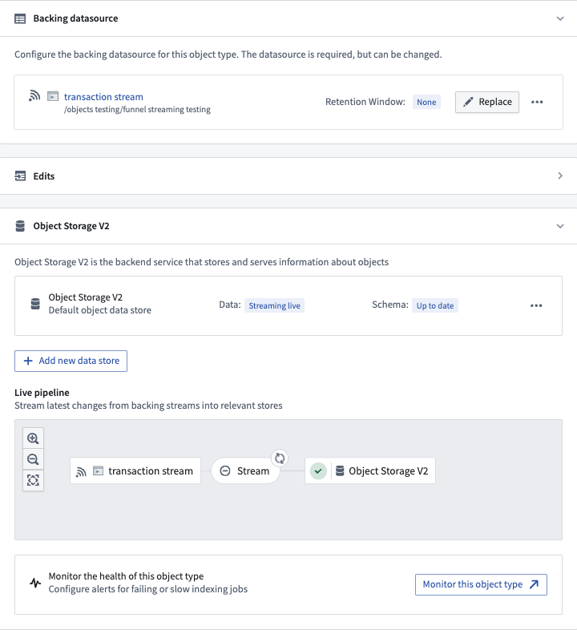
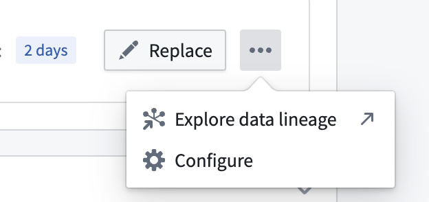
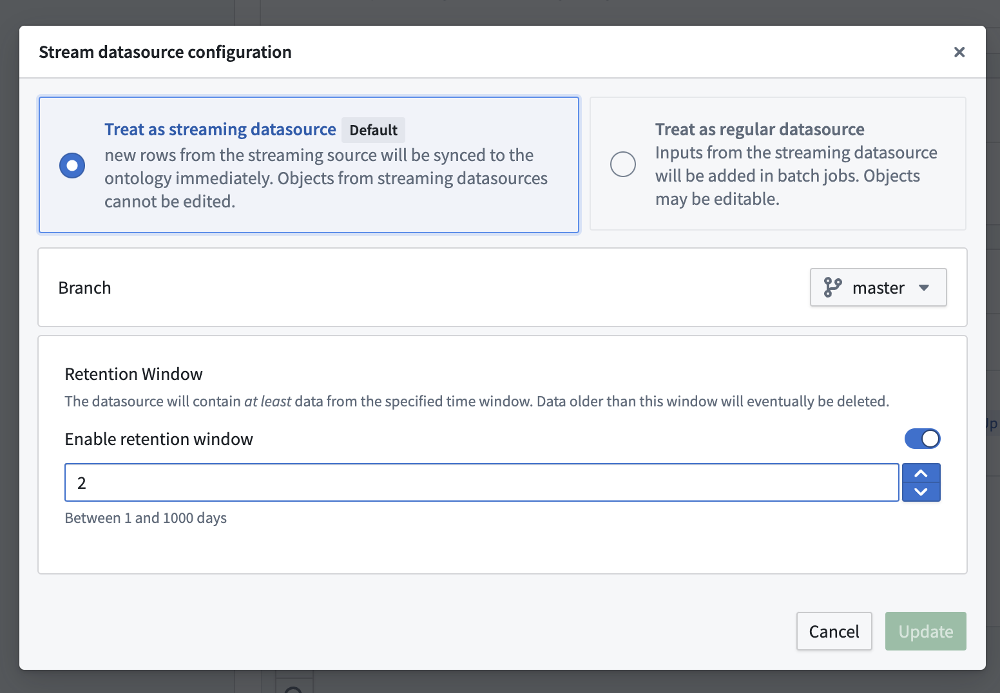

:::callout{theme="warning"}
注意：以下翻译的准确性尚未经过验证。这是使用 [AIP ↗](https://www.palantir.com/platforms/aip/) 从原始英文文本进行的机器翻译。
:::

# Funnel流式管道

除了[批量Ontology数据索引](Funnel%E6%89%B9%E5%A4%84%E7%90%86%E7%AE%A1%E9%81%93.md)之外，Object Storage v2还通过使用[Foundry流](https://www.palantir.com/docs/foundry/data-integration/streams/)作为[输入数据源](../%E5%AF%B9%E8%B1%A1%E6%9D%83%E9%99%90%E7%AE%A1%E7%90%86/%E7%AE%A1%E7%90%86Object%E7%B1%BB%E5%9E%8B%E5%92%8CObject%E5%AE%9E%E4%BE%8B%E5%AE%89%E5%85%A8%E6%80%A7.md#object-input-datasources)，支持低延迟流式数据索引到Ontology。通过不同于非流式Foundry数据集的批量基础设施，流使数据能够在几秒钟或几分钟内索引到Foundry Ontology中，以支持对延迟敏感的操作工作流。

:::callout{theme="neutral"}
如果您对Ontology流式行为有更多疑问，请查看我们的[常见问题](%E5%B8%B8%E8%A7%81%E9%97%AE%E9%A2%98%E8%A7%A3%E7%AD%94.md#can-i-backfill-large-scale-historical-data-for-object-types-with-streaming-datasources)文档。

有关流式管道性能和延迟的指导，请查看我们的[流式性能考虑](https://www.palantir.com/docs/foundry/building-pipelines/streaming-performance-considerations/)文档。
:::

## 流式Object类型的当前产品限制

Object Storage v2中的流使用“最新更新优先”的策略，其中每个流被视为变更日志流。如果您的事件是无序的，您将在Ontology中得到不正确的数据。如果您可以保证输入流中的顺序，Object Storage v2流将按相同的顺序处理您的更新。

Ontology流式行为及其功能集仍在积极开发中；以下是使用Ontology流之前的一些当前产品限制：

* 用户编辑不支持流式Object类型。作为一种解决方法，您可以将用户编辑作为数据更改推送到输入流中，或配置一个具有非流式输入数据源的附加Object类型，以便用户在该辅助Object类型上进行编辑。
* [多数据源Object类型(MDOs)](../%E5%AF%B9%E8%B1%A1%E6%9D%83%E9%99%90%E7%AE%A1%E7%90%86/%E5%A4%9A%E6%95%B0%E6%8D%AE%E6%BA%90Object%E7%B1%BB%E5%9E%8B%EF%BC%88MDOs%EF%BC%89.md)不支持流式Object类型。
* 除了[Workshop](https://www.palantir.com/docs/foundry/workshop/overview/)之外，没有其他Foundry前端应用支持实时数据刷新，因为从历史上看，它们不期望流式更新。尽管基础的Ontology数据对于流式Object类型来说不断变化，但在Workshop之外，每当您需要新数据时，您都需要刷新。
* 在Ontology Manager中Object类型的**数据源**选项卡中，用户能够为Funnel批处理管道出错和无效记录配置[监控器](Funnel%E6%89%B9%E5%A4%84%E7%90%86%E7%AE%A1%E9%81%93.md#monitor-funnel-pipelines)。目前，不支持具有流数据源的Object类型的监控器或指标（例如，管道延迟）。

## 配置流式Object类型

具有流输入数据源的Object类型直接在[Pipeline Builder](https://www.palantir.com/docs/foundry/pipeline-builder/outputs-add-ontology-output/)或[Ontology Manager](../../%E5%BA%94%E7%94%A8/%E6%9C%AC%E4%BD%93%E7%AE%A1%E7%90%86%E5%99%A8/%E6%A6%82%E8%BF%B0.md)中配置，类似于任何其他Foundry Ontology Object类型。

:::callout{theme="neutral"}
如果您尚未配置输入流，可以通过[在数据连接应用中与现有流集成](https://www.palantir.com/docs/foundry/data-connection/set-up-streaming-sync/)或通过[在Pipeline Builder中搭建流管道](https://www.palantir.com/docs/foundry/building-pipelines/create-stream-pipeline-pb/)来创建一个。
:::

创建新Object类型（或使用现有Object类型）后，导航到Ontology Manager中的**数据源**选项卡，在**支持数据源**部分选择一个流输入数据源，如下所示，并将您的更改保存到Foundry Ontology中。

对于输入数据源流的附加配置，请选择省略号按钮以获取更多选项，如下所示。

:::callout{theme="neutral"}
流数据源还可以配置为[多对多链接类型](../../%E5%AE%9A%E4%B9%89%E6%9C%AC%E4%BD%93/%E5%AF%B9%E8%B1%A1%E9%93%BE%E6%8E%A5%E7%B1%BB%E5%9E%8B/Link%20types/%E5%88%9B%E5%BB%BA%E9%93%BE%E6%8E%A5%E7%B1%BB%E5%9E%8B.md)。
:::

## 调试流式管道

流与Ontology之间的接口在概念上可以视为[变更日志数据集](Funnel%E6%89%B9%E5%A4%84%E7%90%86%E7%AE%A1%E9%81%93.md#changelog)。输入流中的每条记录将包含写入Ontology的每个属性的数据。每条记录将更新指定主键的给定Object的所有属性。可以通过在输入流上设置元数据来指定输入记录上的删除。

Funnel将按写入数据源流的顺序索引记录，因此这些流应按主键分区并按事件时间戳排序，这可以在上游[Pipeline Builder](https://www.palantir.com/docs/foundry/pipeline-builder/core-concepts/#pipeline-outputs)管道中完成。

如果您的流管道有问题，请查看[调试失败的流](https://www.palantir.com/docs/foundry/optimizing-pipelines/debug-stream/)文档。
