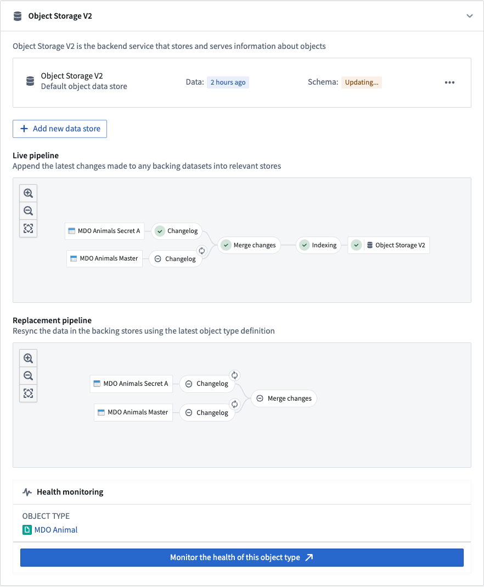

:::callout{theme="warning"}
注意：以下翻译的准确性尚未经过验证。这是使用 [AIP ↗](https://www.palantir.com/platforms/aip/) 从原始英文文本进行的机器翻译。
:::

# 常见问题解答

## 如何知道一个对象类型何时已被索引到 OSv2 中？

Ontology 管理器应用程序有一个专用的管道图，显示漏斗管道中各种任务的状态。图中的 Object Storage v2 节点上的绿色勾表示索引已完成，对象类型可以从 OSv2 中查询。

## 为什么即使之前成功注册到 Object Storage v1（Phonograph），索引任务仍可能失败？

OSv1 和 OSv2 的数据验证略有不同。

OSv1 的行为通常由底层数据存储的行为决定，因为它与底层分布式文档存储和搜索引擎紧密耦合。OSv2 具有更严格的验证，以确保进入 Ontology 的数据质量，并在整个系统中提供更确定的行为和更高的可读性，与 OSv1 相比。

因此，一些在 OSv1 上被接受的索引管道在使用 OSv2 时可能会遇到验证错误。有关此类重大更改的详细列表，请参阅 [Ontology 在 OSv1 和 OSv2 之间的重大更改](../%E5%AF%B9%E8%B1%A1%E5%90%8E%E7%AB%AF/Object%20Storage%20v1%E4%B8%8EObject%20Storage%20v2%E4%B9%8B%E9%97%B4%E7%9A%84%E9%87%8D%E5%A4%A7%E5%8F%98%E6%9B%B4.md) 文档。

## 其中一个任务失败了，但如果我重试可能会成功。我该如何触发重建？

OSv2 管理任务的所有方面，包括任务重试。如果一个任务因临时错误而失败，该错误可能通过重建任务来解决，OSv2 将在大约五分钟后自动重试该任务。如果 OSv2 检测到任务由于无效的数据格式而终止失败，它将仅在有新数据可用时自动重试。在对象类型由受限视图数据源支持的情况下，当数据或策略更改时会触发任务。

## 索引的数据大小是否有限制？

索引大小主要受限于某个给定对象类型被索引到的对象数据库中的存储空间。例如，在 OSv2 数据存储中，这将是搜索节点的磁盘空间。

如果没有足够的磁盘空间，索引任务将不会成功，并将在 Ontology 管理器应用程序中的管道图中报告潜在问题。如果遇到磁盘空间错误，请联系您的 Palantir 代表。

## 我可以回填大规模历史数据到[具有流数据源的对象类型](Funnel%E6%B5%81%E5%BC%8F%E7%AE%A1%E9%81%93.md)吗？

在同步由流数据源支持的对象类型时，有两个阶段：内部流创建和索引。流索引任务的索引延迟与[Funnel 批处理管道](Funnel%E6%89%B9%E5%A4%84%E7%90%86%E7%AE%A1%E9%81%93.md)相当，使用 Spark 大规模并行化历史流数据的初始处理。此索引延迟与[用户对实时 Ontology 数据的编辑](../%E5%AF%B9%E8%B1%A1%E7%BC%96%E8%BE%91/%E7%94%A8%E6%88%B7%E7%BC%96%E8%BE%91%E7%9A%84%E5%BA%94%E7%94%A8%E6%96%B9%E5%BC%8F.md#user-edits-on-live-data)相当。内部流创建通常是限制因素；它利用我们的流基础设施按每条记录处理数据源。

## 流入 Ontology 的预期延迟是多少？

[Funnel 流管道](Funnel%E6%B5%81%E5%BC%8F%E7%AE%A1%E9%81%93.md)中最耗时的部分是 Flink 检查点，以实现"精确一次"流一致性。默认的检查点频率为每秒一次，因此这是数据到达输入流和被索引到 Ontology 之间的主要延迟。我们进行持续实验，通过减少频率甚至完全移除来评估成本/性能/延迟之间的权衡。

如有必要，联系 Palantir 支持以配置行为。

## 流入 Ontology 的预期吞吐量是多少？

索引吞吐量限制为每个对象类型每秒 2 MB 进入[Object Storage v2 对象数据库](../%E5%AF%B9%E8%B1%A1%E5%90%8E%E7%AB%AF/%E6%A6%82%E8%BF%B0.md#object-storage-v2-architecture)。如果您需要更高的索引吞吐量，请联系 Palantir 支持。

## 使用 Ontology 中的流数据源时，我可以指定一个时间戳以便对我的对象进行去重吗？

不可以，[Funnel 流管道](Funnel%E6%B5%81%E5%BC%8F%E7%AE%A1%E9%81%93.md)在索引时保留输入流的顺序。数据应按顺序写入流。这可以通过在上游流管道中按事件时间戳窗口化数据并指定主键使数据进行哈希分区来完成。

## Ontology 流支持变更数据捕获 (CDC) 工作流吗？

[Funnel 流管道](Funnel%E6%B5%81%E5%BC%8F%E7%AE%A1%E9%81%93.md)支持创建、更新和删除工作流。您可以在[变更数据捕获](https://www.palantir.com/docs/foundry/data-integration/change-data-capture/)文档中找到有关如何设置删除元数据的更多文档。

## 使用流数据源时，我可以将部分行写入 Ontology 吗？我可以一次更新几个属性而不是提供整个对象吗？

目前不可以。解决整个对象应在上游管道中完成。如果[stateful streaming](https://www.palantir.com/docs/foundry/building-pipelines/stream-vs-batch/#state-management)由于规模问题不能解决此问题，请联系 Palantir 支持。

## 我可以使用 Ontology 流处理[多对多链接类型](../../%E5%AE%9A%E4%B9%89%E6%9C%AC%E4%BD%93/%E5%AF%B9%E8%B1%A1%E9%93%BE%E6%8E%A5%E7%B1%BB%E5%9E%8B/Link%20types/%E5%88%9B%E5%BB%BA%E9%93%BE%E6%8E%A5%E7%B1%BB%E5%9E%8B.md)吗？

可以，支持。了解更多关于如何配置具有流数据源的 Ontology 类型的信息，请参阅[我们的文档](Funnel%E6%B5%81%E5%BC%8F%E7%AE%A1%E9%81%93.md#configuring-streaming-object-types)。

## 除了 [Object Storage v2](../%E5%AF%B9%E8%B1%A1%E5%90%8E%E7%AB%AF/%E6%A6%82%E8%BF%B0.md#object-storage-v2-architecture)（[物化](../%E5%AF%B9%E8%B1%A1%E7%BC%96%E8%BE%91/%E7%89%A9%E5%8C%96.md)或[自动化](https://www.palantir.com/docs/foundry/automate/overview/)等）外，流是否支持其他[对象数据库](https://www.palantir.com/docs/zh/foundry/object-indexing/object-databases/)？

Ontology 流目前仅由 Object Storage v2 对象数据库支持。如果您需要在其他对象数据库中实现此功能，请联系 Palantir 支持。

## [流数据源的对象类型](../%E5%AF%B9%E8%B1%A1%E7%BC%96%E8%BE%91/%E7%89%A9%E5%8C%96.md)是否支持物化？

不支持；由于用户编辑不支持流数据源的对象类型，物化数据集与流中的存档数据集没有区别。根据当前架构，数据集中的去重视图无法提供。

## 我的 [Funnel 流管道](https://www.palantir.com/docs/zh/foundry/object-indexing/faq/funnel-streaming-pipelines.md)一直在运行。我该如何取消它？

用户无法取消 Funnel 流管道。Funnel 始终保持流活跃，因为生产对象类型需要高可用性。这种设置在原型设计时可能会产生不必要的成本。如果这对您的应用案例构成重大障碍，请联系 Palantir 支持。或者，您可以在原型阶段尝试将对象类型切换为批处理类型。

## 如何在不中断的情况下将我的流数据源从一个流切换到另一个流？

[Funnel 流管道](Funnel%E6%B5%81%E5%BC%8F%E7%AE%A1%E9%81%93.md)有一个启发式方法来判断其管道是否与替换流“最新”，然后再切换到新的流。您可以通过以下步骤更改数据源以指向不同的流或流的分支：

1. 在单独的流（或其他分支）上运行您的新逻辑。
2. 等待新流完成重播，例如在所有历史记录都处理完后。
3. 将您的对象类型输入数据源更改为新流。
4. Funnel 流管道将在新的流上的替换管道完全索引之前保持原始流上的实时管道。
5. 一旦 Funnel 完成切换，您就可以关闭原始流。

## 可能导致意外后果的一些常见错误是什么？

1. 如果您的数据与预期不一致，请确保您的输入流按预期排序。
2. [Funnel 流管道](Funnel%E6%B5%81%E5%BC%8F%E7%AE%A1%E9%81%93.md)执行与[Funnel 批处理管道](Funnel%E6%89%B9%E5%A4%84%E7%90%86%E7%AE%A1%E9%81%93.md)相同的验证。但是，对于流管道，没有机制在用户变换中抛出错误，因为流处理不能暂停，所以无效记录将被丢弃。

## Ontology 流的成本是多少？

[Funnel 流管道](Funnel%E6%B5%81%E5%BC%8F%E7%AE%A1%E9%81%93.md)计算方式与普通流资源相同。有关流资源成本的更多信息，请查看我们的[流计算使用情况](https://www.palantir.com/docs/foundry/building-pipelines/streaming-compute-usage/#calculating-usage)文档。

## 保留窗口如何工作？

保留窗口最初作为 Beta 版本期间的数据大小限制机制开发。因此，它仅作为尽力而为的实现。这意味着保留窗口内的对象实例将是可查询的，但保留窗口外的对象实例最终将被删除。例如，如果保留窗口设置为两周，并且流数据源的某个对象实例上次由输入流于三周前更新，则该对象实例可能会从该对象类型中删除。然而，该对象实例也可能在 Ontology 中保留更长时间，并且在任何特定时间范围内都不能保证被移除。

当前用于从 Ontology “清理”旧数据的机制是通过[管道替换](Funnel%E6%89%B9%E5%A4%84%E7%90%86%E7%AE%A1%E9%81%93.md#replacement-pipelines)，默认情况下每两周运行一次。在替换时，Funnel 流管道从保留窗口的开始重播流，从而从 Ontology 中删除较旧的对象实例。如果您需要更定期地删除旧对象实例，请联系 Palantir 支持。

如果未设置保留窗口，则所有来自输入流源的数据将被摄入 Ontology。

## 为什么我的流源被批处理索引或由于重复错误而失败？

在 [Ontology 管理器](../../%E5%BA%94%E7%94%A8/%E6%9C%AC%E4%BD%93%E7%AE%A1%E7%90%86%E5%99%A8/%E6%A6%82%E8%BF%B0.md)中，您必须始终明确指定您的输入数据源为流；这适用于既具有流数据源的对象类型，也适用于受流支持的[受限视图](../%E5%AF%B9%E8%B1%A1%E6%9D%83%E9%99%90%E7%AE%A1%E7%90%86/%E9%85%8D%E7%BD%AE%E5%8F%97%E9%99%90%E8%A7%86%E5%9B%BE%E6%94%AF%E6%8C%81%E7%9A%84%E5%AF%B9%E8%B1%A1%E7%B1%BB%E5%9E%8B.md)。否则，您的数据源将回退为标准[Funnel 批处理管道](Funnel%E6%89%B9%E5%A4%84%E7%90%86%E7%AE%A1%E9%81%93.md)进行索引。有关详细信息，请查看我们的[配置流对象类型](Funnel%E6%B5%81%E5%BC%8F%E7%AE%A1%E9%81%93.md#configuring-streaming-object-types)文档。

## 我可以通过[Ontology 函数](../../%E5%AE%9A%E4%B9%89%E6%9C%AC%E4%BD%93/%E5%87%BD%E6%95%B0/Functions%20on%20objects/%E6%A6%82%E8%BF%B0.md)查询具有流数据源的对象类型吗？

可以，[查询 Ontology](../%E5%AF%B9%E8%B1%A1%E5%90%8E%E7%AB%AF/%E6%A6%82%E8%BF%B0.md#object-set-service-oss)对于流对象类型和批处理对象类型的工作方式相同。
