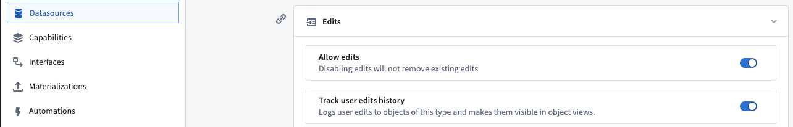
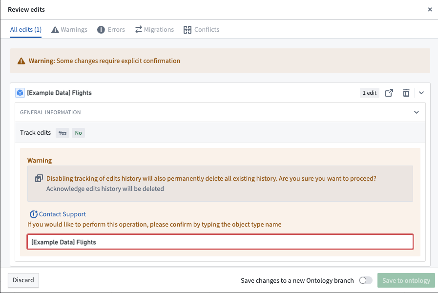

:::callout{theme="warning"}
注意：以下翻译的准确性尚未经过验证。这是使用 [AIP ↗](https://www.palantir.com/platforms/aip/) 从原始英文文本进行的机器翻译。
:::

# 启用用户编辑历史

追踪用户对索引到Object Storage v2中的Objects的编辑历史。可以在Ontology Manager的**数据源**选项卡中使用**跟踪用户编辑历史**切换按钮启用或禁用此功能，如下图所示。

为了允许用户编辑，必须启用[编辑切换](%E7%94%A8%E6%88%B7%E7%BC%96%E8%BE%91%E7%9A%84%E5%BA%94%E7%94%A8%E6%96%B9%E5%BC%8F.md)。

## 常见问题和注意事项

* 编辑历史反映启用**跟踪用户编辑历史**后对Objects所做的更改。启用此功能之前的任何更改都不会被跟踪。
* 一旦启用**跟踪用户编辑历史**，需要几分钟的时间来初始化。在这段短时间内，用户无法对这些Objects执行操作。
* 目前，不支持从Object Storage v1迁移用户编辑历史到Object Storage v2。因此，Object Storage v1中跟踪的任何编辑历史在过渡到Object Storage v2后将丢失。
* 当前不支持跟踪对权限标记属性的用户编辑。
* 拥有Object当前状态访问权限的用户（具有相同主键的Object）可以访问Object的整个历史。这意味着如果一个Object被删除并重新创建，用户仍然可以看到删除操作前发生的历史。

启用**跟踪用户编辑历史**后，可以将[编辑历史微件](https://www.palantir.com/docs/foundry/workshop/widgets-edits-history/)添加到Workshop模块或Workshop支持的Object视图中，以显示编辑历史。

## 禁用编辑历史

禁用**跟踪用户编辑历史**将永久删除该Object类型的所有现有编辑历史。在保存Ontology之前，用户将收到警告，并且必须确认编辑历史将被删除的声明。

