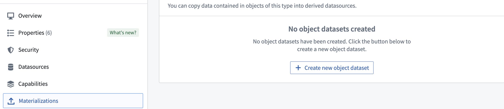
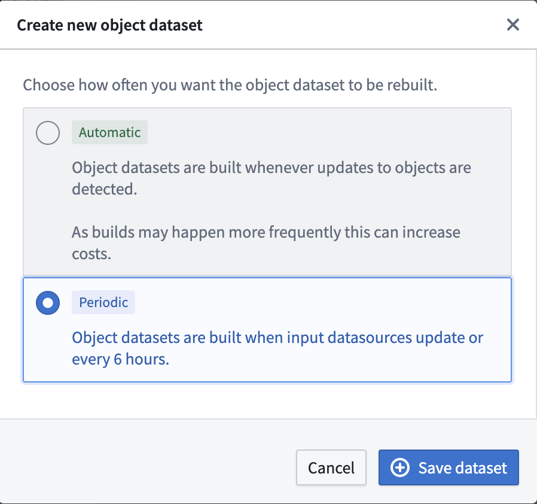
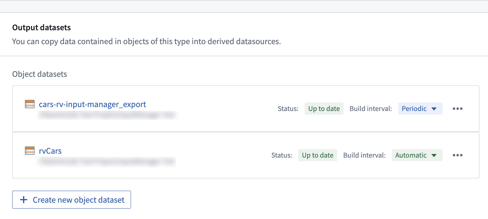
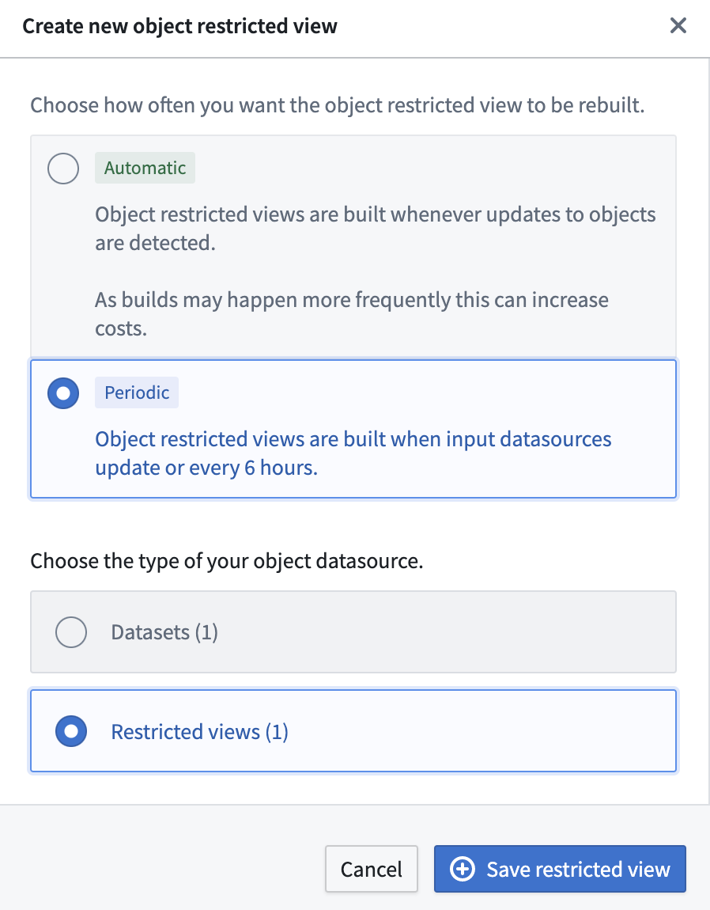
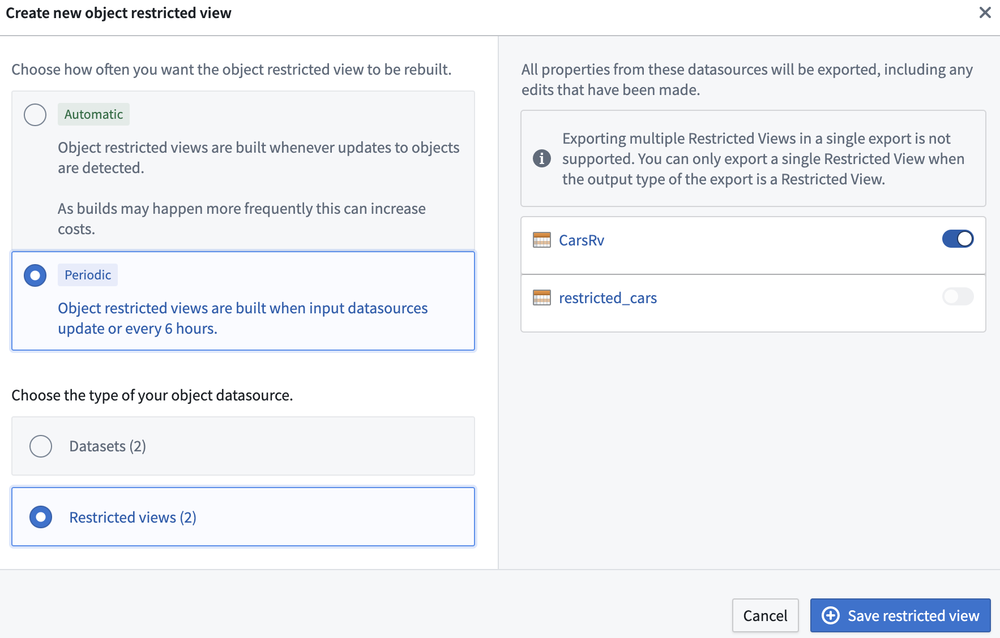
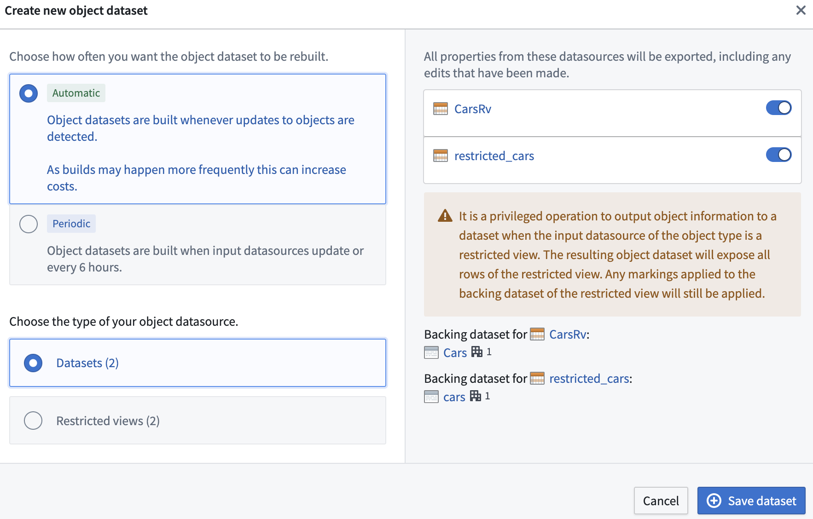

:::callout{theme="warning"}
注意：以下翻译的准确性尚未经过验证。这是使用 [AIP ↗](https://www.palantir.com/platforms/aip/) 从原始英文文本进行的机器翻译。
:::

# 物化

最新的数据对许多 Foundry 工作流至关重要。Ontology 用户可以通过结合来自输入数据源和用户编辑的数据，创建来自 Ontology 的索引数据的**物化**，其中包含每个 Object 实例的最新状态。

## 物化的应用案例

物化的两个主要应用案例是：

* 搭建需要每个 Object 实例的最新状态（包括用户编辑）的下游 Foundry 管道。
* 以启用下载包含所有 Object 实例最新状态的 Ontology 数据，以支持一种 Object 类型。

:::callout{theme="neutral"}
我们建议通过创建物化数据集并通过其他 Foundry 数据集的现有下载工作流（如 [数据导出](https://www.palantir.com/docs/foundry/analytics/exporting-outputs/#data-export) 和通过 [Foundry 变换](https://www.palantir.com/docs/foundry/code-repositories/prepare-datasets-download/#prepare-datasets-for-download) 导出）来在 Foundry 中协调批量下载。
:::

## 创建物化数据集

通过在 Ontology 管理器的**数据源**选项卡中[切换编辑配置](%E7%94%A8%E6%88%B7%E7%BC%96%E8%BE%91%E7%9A%84%E5%BA%94%E7%94%A8%E6%96%B9%E5%BC%8F.md)，导航到**物化**选项卡。在**物化**选项卡中，您可以根据[输入数据源类型](../%E5%AF%B9%E8%B1%A1%E6%9D%83%E9%99%90%E7%AE%A1%E7%90%86/%E7%AE%A1%E7%90%86Object%E7%B1%BB%E5%9E%8B%E5%92%8CObject%E5%AE%9E%E4%BE%8B%E5%AE%89%E5%85%A8%E6%80%A7.md#object-input-datasources)创建物化 Object 数据集或 Object 限制视图，并进行多种配置。

## 数据输出数据集与物化数据集的比较

在 Object 存储 V1（Phonograph）中，[数据输出数据集](https://www.palantir.com/docs/foundry/slate/references-writeback/)相当于物化数据集。要启用用户编辑某种 Object 类型或具有连接表的多对多链接类型，在 OSv1 中需要数据输出数据集。

Object 存储 V2 不需要物化数据集来启用用户编辑。相反，用户可以通过在 Ontology 管理器的**数据源**选项卡中切换**编辑**配置来启用某种 Object 类型的用户编辑。这使得在 OSv2 中物化是非必填的，用户只需要在上述两个主要应用案例中创建物化。OSv2 还允许创建多个物化数据集，以便用户仅物化某种 Object 类型的部分属性。

OSv1 数据输出数据集与 OSv2 物化数据集之间还有其他行为差异，如下所述。

### 数据输出和物化数据集中的搭建计划

Object 存储 V1（Phonograph）数据输出数据集和 Object 存储 V2 物化数据集以不同方式处理搭建计划。

* 在 OSv1 中，当有新的用户编辑时，没有机制来触发数据输出数据集的搭建。相反，用户可以创建[计划](https://www.palantir.com/docs/foundry/building-pipelines/create-schedule/)，以按照他们希望的频率搭建他们的数据输出数据集。当没有新数据时，这些搭建会自动中止，以避免使用任何额外的计算资源。如果没有设置计划且未搭建数据输出数据集，数据输出数据集中的数据可能无法准确代表 Ontology。
* OSv2 旨在以不同方式解决两个独立的应用案例。
  * 若要在[编辑应用](%E7%94%A8%E6%88%B7%E7%BC%96%E8%BE%91%E7%9A%84%E5%BA%94%E7%94%A8%E6%96%B9%E5%BC%8F.md)时立即反映用户编辑，用户可以启用用户编辑的**自动**传播。此模式会自动将用户编辑传播到配置的物化数据集中（延迟几分钟）。这可能会产生额外费用，因为可能会根据新用户编辑的频率发生更频繁的搭建。
  * 如果用户编辑传播到物化数据集的延迟不是关键问题，用户可以通过配置**定期**搭建来降低成本。在此模式下，物化数据集会在输入数据源有新数据时或每6小时重建一次。

### 数据输出和物化数据集的保留

数据输出和物化数据集的保留方式不同。

* 在 OSv1 中，数据输出数据集的行为类似于常规数据集，意味着可以在平台内指定特定的[保留策略](https://www.palantir.com/docs/foundry/retention/overview/)。这使用户可以在定期搭建数据输出数据集时回顾 Object 类型状态的历史快照。

* 在 OSv2 中，物化数据集的保留不可自定义。历史事务会被不断删除，仅保证最新快照可用。在这种情况下，如果保留 Object 类型状态的历史快照很重要，用户需要在下游设置变换。

### 数据输出和物化数据集中的数据集架构

Object 存储 V1（Phonograph）数据输出数据集和 Object 存储 V2 物化数据集与输入数据源架构的关系不同。

* 在 OSv1 中，输入数据源的架构被复制并用作数据输出数据集的架构。
* OSv2 改变了这种行为，以增加 Foundry Ontology 的可读性。由于用户从 Ontology 中物化数据，物化数据集使用的架构是从 Ontology 定义中复制的，而不是依赖于支持的数据源配置。具体来说，每个属性的 [API 名称](../../%E5%AE%9A%E4%B9%89%E6%9C%AC%E4%BD%93/%E5%AF%B9%E8%B1%A1%E9%93%BE%E6%8E%A5%E7%B1%BB%E5%9E%8B/Properties/%E5%85%83%E6%95%B0%E6%8D%AE%E5%8F%82%E8%80%83.md#metadata-reference) 元数据被用作物化数据集的架构。如果您希望在[从 OSv1 迁移到 OSv2](../%E5%AF%B9%E8%B1%A1%E5%90%8E%E7%AB%AF/%E4%BB%8E%E5%AF%B9%E8%B1%A1%E5%AD%98%E5%82%A8%20v1%20%28Phonograph%29%20%E8%BF%81%E7%A7%BB%E5%88%B0%E5%AF%B9%E8%B1%A1%E5%AD%98%E5%82%A8%20v2.md) 时继续使用输入数据源的架构（例如，为现有数据输出数据集保证向后兼容性），请联系您的 Palantir 代表。

:::callout{theme="warning"}
`__` 前缀的列（例如 `__is_deleted`, `__patch_offset`）在物化数据集中是用于 Foundry 去重目的的元数据列，不代表 Object 类型的任何状态信息。这些列可能在未来版本中被重命名或删除，且不会事先警告，不应在生产工作流中使用。
:::

### 数据输出和物化数据集中的限制视图

Object 存储 V1（Phonograph）不允许物化使用限制视图作为输入数据源的 Object 类型的[限制视图](https://www.palantir.com/docs/foundry/security/restricted-views/)。用户只能物化包含限制视图输入数据源的支持数据集中所有行的数据输出数据集。然后，用户需负责基于其访问限制正确保障对数据输出数据集的访问。

在 Object 存储 V2 中，用户可以为使用限制视图作为输入数据源的[细粒度权限](../%E5%AF%B9%E8%B1%A1%E6%9D%83%E9%99%90%E7%AE%A1%E7%90%86/%E9%85%8D%E7%BD%AE%E5%8F%97%E9%99%90%E8%A7%86%E5%9B%BE%E6%94%AF%E6%8C%81%E7%9A%84%E5%AF%B9%E8%B1%A1%E7%B1%BB%E5%9E%8B.md#using-restricted-views-to-back-object-types) Object 类型配置常规数据集或限制视图作为物化资源，如下所示。

在拥有[多个输入数据源](../%E5%AF%B9%E8%B1%A1%E6%9D%83%E9%99%90%E7%AE%A1%E7%90%86/%E5%A4%9A%E6%95%B0%E6%8D%AE%E6%BA%90Object%E7%B1%BB%E5%9E%8B%EF%BC%88MDOs%EF%BC%89.md)的 Object 类型的情况下，用户可以通过选择他们希望物化数据的输入数据源来配置其物化数据集。如果未选择某个输入数据源，则从该输入数据源映射的 Object 类型属性将不会在物化数据集中反映。如果某些输入数据源是限制视图，用户有两种选择：

* 用户可以选择其中一个限制视图资源以物化为[限制视图](https://www.palantir.com/docs/foundry/security/restricted-views/#restricted-views)。下面显示了一个示例配置。

* 用户可以选择多个输入数据源，但在这种情况下，他们只能将 Ontology 数据物化为[Foundry 数据集](https://www.palantir.com/docs/foundry/data-integration/datasets/)。此限制存在是因为不同的限制视图输入数据源可以具有[不同的策略配置](https://www.palantir.com/docs/foundry/security/restricted-views/#restricted-view-policies)，且限制视图当前不支持设置列级策略。下面显示了一个示例配置。

