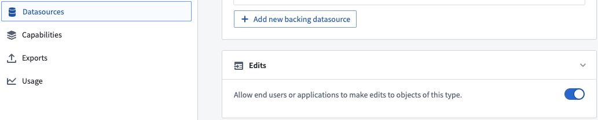
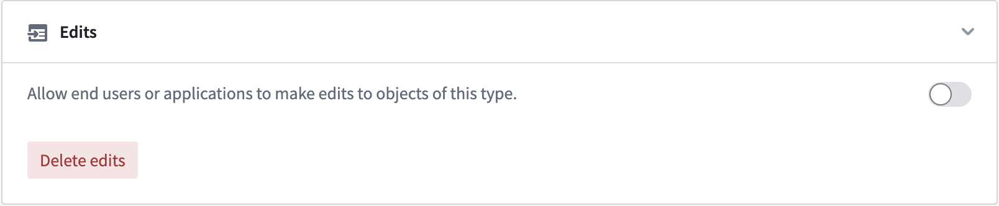
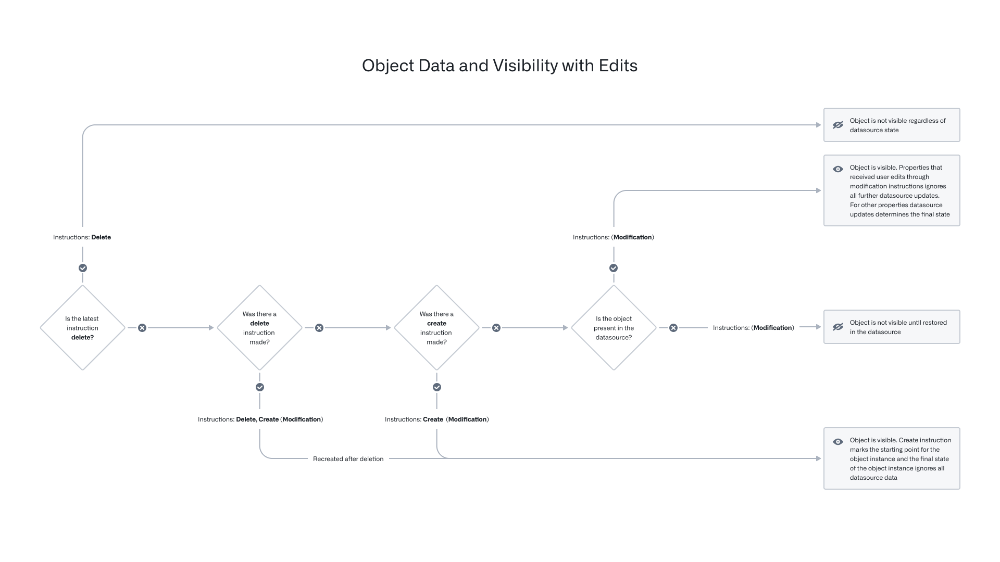
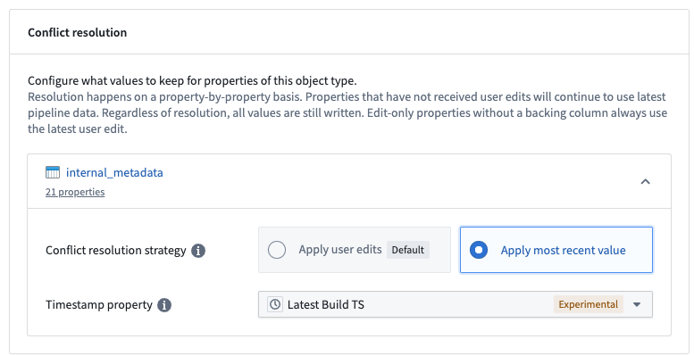
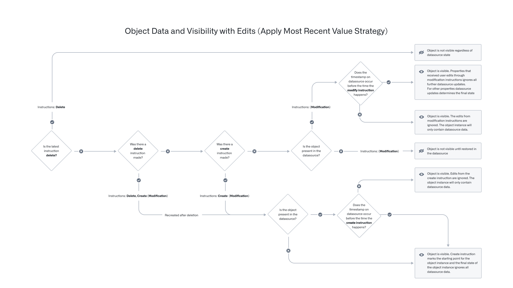

:::callout{theme="warning"}
注意：以下翻译的准确性尚未经过验证。这是使用 [AIP ↗](https://www.palantir.com/platforms/aip/) 从原始英文文本进行的机器翻译。
:::

# 用户编辑的应用方式

用户编辑可以通过在Ontology管理器的**数据源**选项卡中使用**编辑**切换按钮启用或禁用，如下图所示。

## 通过操作编辑对象

本节描述Ontology如何使用操作管理对象编辑。

当一个操作被应用于一个对象、链接实例或对象集时，数据修改逻辑会立即应用于对象数据库中的索引，并定期刷新到持久存储中，以Foundry数据集的形式由Funnel拥有和管理。有关更多信息，请参见[用户编辑的持久存储](#persistent-storage-of-user-edits)文档。

### 实时数据上的用户编辑

当一个操作被触发时，操作服务会向Funnel服务发送修改指令。该指令存储在Funnel管理的队列中，该队列具有偏移量跟踪功能，以支持同时用户编辑。对象存储V2跟踪任何对象类型和多对多链接类型（通过合并表）的这些偏移量。偏移量应用于对象数据库中实时索引的数据；如果在Ontology查询中读取对象发生在用户修改发送之后，读取的对象保证包含用户编辑。

### 如何丢弃/清除/删除现有用户编辑

已包含用户编辑的数据只能通过附加的用户编辑进行更新。除了通过附加的用户编辑（例如，对象操作）更新对象或重新创建对象之外，没有直接撤销单个用户编辑或删除的机制。

在某些情况下，可能需要丢弃所有现有的用户编辑，以便将所有对象实例的状态重置为与输入数据源中的状态相同。例如，您可能希望在将对象类型发布到生产环境之前，删除在对象类型测试期间应用的所有用户编辑。

对象存储V2提供了一个用于迁移用户编辑的[模式迁移框架](%E7%AE%A1%E7%90%86%E6%A8%A1%E5%BC%8F%E6%9B%B4%E6%94%B9.md)。可以使用["删除所有编辑"](%E7%AE%A1%E7%90%86%E6%A8%A1%E5%BC%8F%E6%9B%B4%E6%94%B9.md#list-of-supported-schema-migrations-in-osv2)指令丢弃对象类型上的所有现有用户编辑。此迁移指令可以通过点击Ontology管理器中**数据源**选项卡的**编辑**部分中的**删除编辑**按钮来应用。

对象存储V1（Phonograph）不支持模式迁移，但从对象类型定义中移除数据输出数据集配置将删除所有现有用户编辑，可以用作变通方法。

## Ontology实体版本控制

在应用操作的过程中，加载对象类型元数据信息和对象实例数据用于各种目的，如操作验证，[函数](../../%E5%AE%9A%E4%B9%89%E6%9C%AC%E4%BD%93/%E5%8A%A8%E4%BD%9C%E7%B1%BB%E5%9E%8B/Function-backed%20actions/%E6%A6%82%E8%BF%B0.md)和操作[副作用](../../%E5%AE%9A%E4%B9%89%E6%9C%AC%E4%BD%93/%E5%8A%A8%E4%BD%9C%E7%B1%BB%E5%9E%8B/Side%20effects/%E6%A6%82%E8%BF%B0.md)。对象实例可能会在应用操作的过程中发生更改，因此必须保证事务性以避免潜在的数据正确性问题（例如，将操作应用于对象实例的错误版本）。

Ontology包括用于检查对象类型和对象实例版本一致性的机制，在对象存储V1（Phonograph）和对象存储V2之间有不同的行为。

### 前端消费者与操作服务器之间的实体版本控制

考虑以下场景：用户在[操作表单](../../%E5%AE%9A%E4%B9%89%E6%9C%AC%E4%BD%93/%E5%8A%A8%E4%BD%9C%E7%B1%BB%E5%9E%8B/%E5%85%A5%E9%97%A8.md#edit-parameters)中加载对象实例参数的版本`{V1, V2, V3, ...}`。前端消费者应用使用这些对象参数调用操作服务器的`/apply`端点，但该请求不包括版本信息。在接收到此请求后，操作服务器在`/apply`端点加载这些对象的版本为`{V1', V2', V3', ...}`。请注意，前端加载的版本`{V1, V2, V3, ...}`与操作服务器加载的版本`{V1', V2', V3', ...}`可能并不总是相同的。

### 操作服务器内的实体版本控制

#### 对象存储V1（Phonograph）

在对象存储V1（Phonograph）中，操作服务器会跟踪已加载对象的版本，并在操作执行过程中从缓存加载相同版本。当用户编辑在对象存储V1（Phonograph）中应用时，对象版本包含在请求中。然后对象存储V1（Phonograph）检查是否有任何对象版本已经更改，如果检测到更改，将抛出`StaleObject`错误。

这些检查确保了操作服务器内的一般一致性。例如，对象存储V1保证操作将在对象的同一版本上生成同步[webhook](../../%E5%AE%9A%E4%B9%89%E6%9C%AC%E4%BD%93/%E5%8A%A8%E4%BD%9C%E7%B1%BB%E5%9E%8B/Side%20effects/Webhooks.md)，执行、验证和应用编辑。请注意，对象属性级别的更改未被检查，因此对象不相关属性上的用户编辑可以触发`StaleObject`冲突。

#### 对象存储V2

在对象存储V2中，操作服务器在将用户编辑发布到Funnel服务之前会进行自己的对象版本检查，但与对象存储V1（Phonograph）相比，仅在服务器收集的版本子集上进行检查。

操作服务器仅检查用于生成编辑的直接对象版本，例如某个对象`A`的版本被复制到对象`B`上，这些版本仅与编辑过的对象版本进行检查。

这种行为减少了`StaleObject`冲突的频率，但在OSv2中保证较弱。在对象存储V2中，操作服务始终在整个操作`/apply`过程中加载相同版本的对象，但不保证在编辑生成之外读取的对象在操作过程中没有更改。

#### 跨后端操作

如果一种操作类型同时修改OSv1和OSv2中的对象，则被认为是“跨后端”的。在这种情况下，操作服务会对以下内容进行检查：

* 所有在OSv1中读取和/或编辑的对象，以及
* 所有在OSv2中编辑的对象。

## 用户编辑的持久存储

对象数据库中所有索引数据被视为临时的，需要以其他方式持久存储所有Ontology数据。同样，通过操作应用的用户编辑也必须被持久存储。支持对象类型的Foundry数据源已经以Foundry数据集、受限视图等形式持久存储。

如[Funnel管道文档](../%E5%AF%B9%E8%B1%A1%E7%B4%A2%E5%BC%95/Funnel%E6%89%B9%E5%A4%84%E7%90%86%E7%AE%A1%E9%81%93.md)中所讨论的，Funnel服务拥有和管理多个Foundry数据集，包括一个合并数据集，该数据集结合了来自数据源和用户编辑的数据。合并数据集是自动搭建的；这确保了存储在队列中的用户编辑在Foundry中被持久存储，并且队列被清空以防止队列变得过大。默认情况下，此搭建任务在以下情况下触发：

* 每当对象类型数据源中有新的数据事务时，或
* 在数据源中没有新数据的情况下，如果检测到任何对象上的编辑，则每6小时触发一次。

## 解决用户编辑和数据源更新冲突

在Foundry Ontology中，对象实例可以由输入数据源和用户编辑创建和修改。当单个对象实例（即具有特定主键值的行或对象）接收到来自输入数据源和用户编辑的数据时，这些接收到的值必须通过*冲突解决策略*透明地解决。

有两种解决冲突的策略：

* [策略1：应用用户编辑（默认）](#strategy-1-apply-user-edits-default)
* [策略2：应用最新值](#strategy-2-apply-most-recent-value)

### 策略1：应用用户编辑（默认）

使用此策略，对象实例的最终状态始终由应用于其的用户编辑决定，无论同一对象实例未来的任何数据源更新。

请参阅下面的流程图，以根据用户编辑和数据源更新确定对象实例的最新状态。

下表显示了在接收到用户编辑和输入数据源更新后，特定对象实例的状态将如何根据“用户编辑优先”的冲突解决策略进行更新。

| 时间 | 当前数据源行状态 | 用户编辑 | 最终对象状态 | 说明 |
| --- | --- | --- | --- | --- |
| T0 | `columns = {pk_column = pk1, col1 = val1, col2 = val2}` |  | `properties = {pk_column = pk1, col1 = val1, col2 = val2}, deleted = false` |  |
| T1 | `columns = {}` |  | `properties = {}, deleted = true` | 行从数据源中消失，对象实例不再存在于Foundry Ontology中 |
| T2 | `columns = {pk_column = pk1, col1 = val1, col2 = val2}` |  | `properties = {pk_column = pk1, col1 = val1, col2 = val2}, deleted = false` | 相同行在数据源中重新出现 |
| T3 | `columns = {pk_column = pk1, col1 = val1, col2 = val2}` | 修改对象：`properties = {pk_column = pk1, col2 = newVal2}` | `properties = {pk_column = pk1, col1 = val1, col2 = newVal2}, deleted = false` | 用户运行`修改对象`操作 |
| T4 | `columns = {}` |  | `properties = {}, deleted = true` | 行再次从数据源中消失，对象实例不再存在于Foundry Ontology中 |
| T5 | `columns = {pk_column = pk1, col1 = val1, col2 = val2}` |  | `properties = {pk_column = pk1, col1 = val1, col2 = newVal2}, deleted = false` | 相同行在数据源中重新出现，并且当行重新出现时，先前的用户编辑仍然应用于对象实例 |
| T6 | `columns = {pk_column = pk1, col1 = newVal1, col2 = val2}` |  | `properties = {pk_column = pk1, col1 = newVal1, col2 = newVal2}, deleted = false` | 未编辑的属性（`col1`）从输入数据源接收到数据更新，并应用于对象实例 |
| T7 | `columns = {pk_column = pk1, col1 = newVal1, col2 = val2}` | 删除对象 | `properties = {}, deleted = true` | 用户运行`删除对象`操作，对象实例不再存在于Foundry Ontology中 |
| T8 | `columns = {pk_column = pk1, col1 = newVal1, col2 = val2, col3 = null}` |  | `properties = {}, deleted = true` |  |
| T9 | `columns = {pk_column = pk1, col1 = newVal1, col2 = val2, col3 = null}` | 创建对象：`properties = {pk_column = pk1, col3 = val3}` | `properties = {pk_column = pk1, col1 = null, col2 = null, col3 = val3}, deleted = false` | 用户运行`创建对象`操作 |
| T10 | `columns = {pk_column = pk1, col1 = newVal1, col2 = newVal2, col3 = newVal3}` |  | `properties = {pk_column = pk1, col1 = null, col2 = null, col3 = val3}, deleted = false` | `col3`在输入数据源中更新，但由于先前的`创建对象`操作，不再考虑对象实例的最终状态 |
| T11 | `columns = {pk_column = pk1, col1 = newVal1, col2 = newVal2, col3 = newVal3}` | 修改对象：`properties = {pk_column = pk1, col2 = newVal22}` | `properties = {pk_column = pk1, col1 = null, col2 = newVal22, col3 = val3}, deleted = false` | 用户运行`修改对象`操作 |
| T12 | `columns = {}` |  | `properties = {pk_column = pk1, col1 = null, col2 = newVal22, col3 = val3}, deleted = false` | 行从数据源中消失，但对象实例仍然存在于Foundry Ontology中，因为它是最后由用户编辑创建的 |
| T13 | `columns = {pk_column = pk1, col1 = newVal1, col2 = newVal2, col3 = newVal3}` | 删除对象 | `properties = {}, deleted = true` | 行重新出现，但用户运行`删除对象`操作，对象实例被删除 |
| T14 | `columns = {pk_column = pk1, col1 = newVal1, col2 = newVal2, col3 = newVal3}` | 修改对象：`properties = {pk_column = pk1, col2 = newVal2, col3 = val3}` | `properties = {}, deleted = true` | 用户在已删除的对象实例上运行`修改对象`操作；任何`修改对象`操作调用都将失败 |

### 策略2：应用最新值

使用此策略，用户编辑是有条件应用的；即，用户编辑仅在用户编辑的时间戳比来自数据源的给定对象实例的时间戳值更新时才应用。

#### 配置

冲突解决策略在对象类型级别配置，仅支持OSv2对象类型。

用户可以在Ontology管理器的**数据源**部分配置此选项。对象类型的每个数据源可以有不同的解决策略。例如，对于由两个数据源支持的对象类型，一个数据源可以使用`应用用户编辑（默认）`，而另一个数据源可以使用`应用最新值`。`应用最新值`选项要求数据源包含具有时间戳类型的属性；日期属性类型对此选项无效。时间戳属性用于比较和决定是否应用用户编辑。时间戳属性必须为协调世界时（UTC）。

#### 行为

一旦为数据源保存了`应用最新值`冲突解决策略，任何\_未来的\_用户编辑将有条件地应用于数据源支持的属性。这通过比较对象实例上的时间戳与应用的最新用户编辑的时间戳来实现。如果对象的时间戳早于用户编辑时间，则应用用户编辑，否则忽略。

如果编辑跨多个数据源更新属性，则这些编辑是否有条件应用或始终应用将由支持该属性的数据源的解决策略决定。

请参阅下面更新的流程图，以根据用户编辑和数据源更新确定对象实例的最新状态。

以下示例说明了这种行为。假设有一个`Ticket`对象类型的三个对象实例，具有以下数据，其中启用了`应用最新值`选项，并且有一个操作类型`更改优先级`将工单的优先级修改为`P0`。

|Ticket ID|标题       |时间戳        |优先级|
|---------|-----------|--------------|-----|
|101      |工单一     |2010年1月1日  |P1   |
|102      |工单二     |2050年1月1日  |P2   |
|103      |工单三     |              |P2   |

* 如果对工单一应用`更改优先级`操作，由于用户编辑在数据源的时间戳值之后，优先级将设置为`P0`。
* 如果对工单二应用`更改优先级`操作，由于用户编辑在数据源的时间戳值之前，优先级将保持为`P2`。
* 如果对工单三应用`更改优先级`操作，由于数据源的时间戳值不存在，用户编辑总是应用，所以优先级将设置为`P0`。

#### 仅编辑属性

对于[仅编辑属性](../../%E5%AE%9A%E4%B9%89%E6%9C%AC%E4%BD%93/%E5%AF%B9%E8%B1%A1%E9%93%BE%E6%8E%A5%E7%B1%BB%E5%9E%8B/Properties/%E4%BB%85%E7%BC%96%E8%BE%91%E5%B1%9E%E6%80%A7.md)，无论输入数据源上的时间戳如何，用户编辑总是会被应用。

回到[上述](#behavior)的工单示例，考虑下表：

|Ticket ID|标题       |时间戳        |优先级| 团队（仅编辑属性） |
|---------|-----------|--------------|-----|---------|
|102      |工单二     |2050年1月1日  |P2   | 销售 |

假设使用一个操作类型`更改团队`将`团队`属性修改为`招聘`。如果对`工单二`应用`更改团队`操作，团队将设置为`招聘`。无论使用哪种策略解决冲突，由于`团队`是一个仅编辑属性，编辑将被应用。

当操作同时修改仅编辑和普通属性时，行为保持不变。普通属性编辑根据条件应用，而仅编辑属性编辑总是应用。

#### 仅考虑输入数据源值

请注意，Ontology仅比较来自输入数据源的时间戳。即使用户通过用户编辑更改了时间戳属性，条件比较也只会在输入数据源的时间戳和用户编辑应用时间之间进行。

由于这种行为，时间戳属性必须由输入数据源的时间戳列支持。如果源系统没有提供时间戳值来指示数据馈送的更新时间，输入数据源的时间戳列可以在数据管道中进行修改。

回到[上述](#behavior)的工单示例，考虑下表：

|Ticket ID|标题     |时间戳        |优先级|
|---------|--------|-------------|-----|
|101      |工单一   |2010年1月1日|P1   |

假设使用一个操作类型`更改时间戳`将上述工单的时间戳修改为`2050年1月1日`。

|Ticket ID|标题     |时间戳                        |优先级|
|---------|--------|-----------------------------|-----|
|101      |工单一   |~~2010年1月1日~~ 2050年1月1日|P1   |

如果现在对工单一应用`更改优先级`操作，优先级仍将设置为`P0`。
尽管对象实例的时间戳已更改，但比较只会在输入数据源的时间戳和用户编辑应用时间之间进行。
