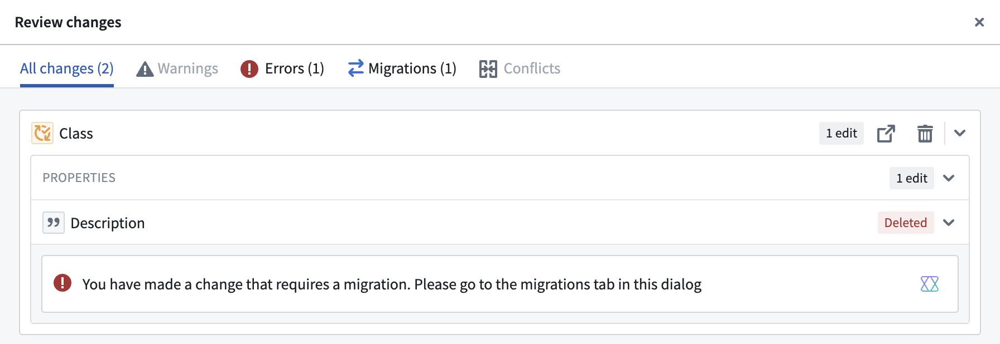
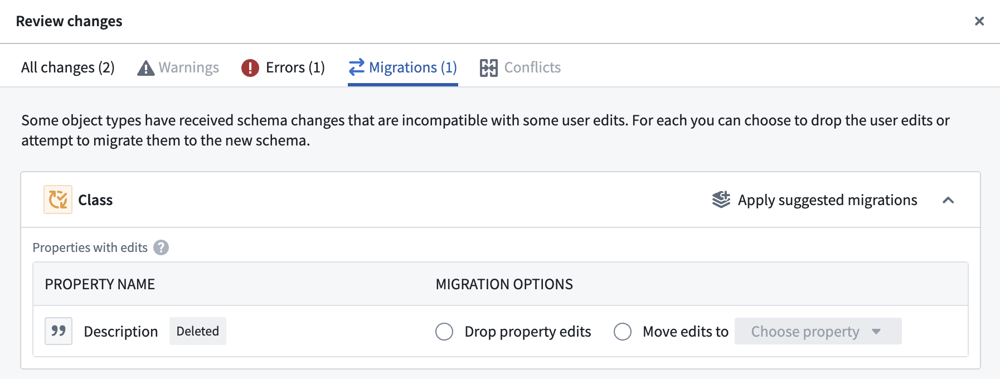
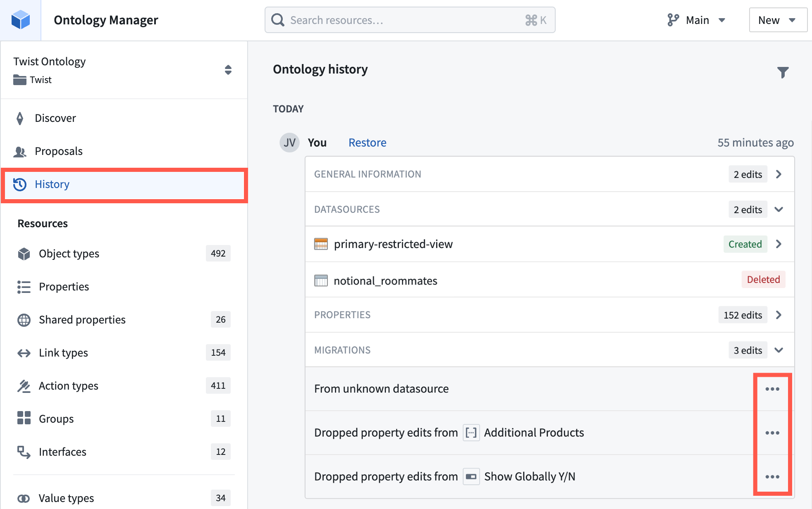

:::callout{theme="warning"}
注意：以下翻译的准确性尚未经过验证。这是使用 [AIP ↗](https://www.palantir.com/platforms/aip/) 从原始英文文本进行的机器翻译。
:::

# 管理模式更改

## 更改对象类型模式

基于Foundry Ontology搭建的工作流和应用程序应随着组织需求的变化而发展；在某些情况下，这种发展可能涉及以需要其他地方额外更改的方式更新对象类型的模式（“重大更改”）。模式的重大更改示例包括更改现有属性的数据类型、更改对象类型的支持数据源或更改对象类型的主键。请参阅下文了解[重大模式更改的完整列表](#list-of-breaking-schema-changes)。

在对象存储V1（Phonograph）中，用户界面会阻止此类模式更改，特别是当对象类型已接收到用户编辑时。这是因为在OSv1中，这些用户编辑无法迁移；相反，重大更改将导致现有用户编辑的丢失，除非可以进行耗时且复杂的人工干预。

对象存储V2取消了此类模式更改的限制，以促进灵活和迭代的工作流构建。为此，OSv2提供了一个模式迁移框架，其中包含一系列预定义的迁移，可在重大模式更改后应用于现有用户编辑。Ontology Manager会自动检测重大模式更改，并指导用户从预定义列表中选择迁移选项。请参阅下文了解[支持的迁移完整列表](#list-of-supported-schema-migrations-in-osv2)。

### 示例工作流

在此示例工作流中，用户从一个已存在用户编辑的对象类型中删除了`Year`属性。Ontology Manager会自动将此识别为重大模式更改，并显示需要迁移的警告，如下所示。

除了显示警告外，当用户想要将更改保存到Ontology时，Ontology Manager将在**审核编辑**界面中显示一个**迁移**标签。Ontology Manager将阻止用户保存更改，直到他们为重大更改定义迁移。这防止更改破坏其他工作流。

当用户导航到**迁移**标签时，Ontology Manager根据重大更改的类型显示可用的迁移选项，如下所示。

一旦用户在Ontology Manager中指定并保存了模式更改，就会在后台为对象类型创建一个新的模式版本，并协调相应的[替换Funnel批处理管道](../%E5%AF%B9%E8%B1%A1%E7%B4%A2%E5%BC%95/Funnel%E6%89%B9%E5%A4%84%E7%90%86%E7%AE%A1%E9%81%93.md#funnel-batch-pipelines)以更新对象类型的索引。新的对象类型版本将在替换管道完成并声明新版本已完全[由对象数据库填充](../%E5%AF%B9%E8%B1%A1%E7%B4%A2%E5%BC%95/Funnel%E6%89%B9%E5%A4%84%E7%90%86%E7%AE%A1%E9%81%93.md#hydration)后，可供对象集服务（OSS）和Ontology API的其他使用者查询。

## 重大模式更改列表

以下Ontology中的更改被视为重大模式更改：

* 更改对象类型的输入数据源
* 更改对象类型的主键
* 更改属性的数据类型
* 更改已接收到用户编辑的属性的ID
* 删除已接收到用户编辑的属性

## 非重大模式更改列表

以下Ontology中的更改**不**被视为重大模式更改：

* 更改已接收到用户编辑的属性的显示名称、标题键、渲染提示、类型类或可见性
* 删除属性或更改从未接收到用户编辑的属性的模式

## OSv2中支持的模式迁移列表

以下是当前在对象存储V2中支持的模式迁移完整列表。

* **删除所有属性编辑：** 该迁移指令删除对象类型特定属性上的所有现有用户编辑。对象类型其他属性上的用户编辑不受影响。当从对象类型中删除属性并且没有新属性作为替代时，通常使用此指令。
* **删除所有编辑：** 该迁移指令删除对象类型所有属性上的所有现有用户编辑。当此迁移运行时，对象类型的所有对象实例的状态将重置为输入数据源中的数据。
* **移动编辑：** 该迁移指令移动特定属性或整个对象类型上的所有现有用户编辑。此指令通常在两种情况下使用：
  * 当现有属性被重命名或删除并由新属性替代时，或
  * 当对象类型的输入数据源被另一个数据源替代时。

:::callout{theme="neutral"}
每次迁移最多只能应用500个编辑。如果编辑数量超过此限制，则必须分批执行迁移。
:::

* **转换为新类型：** 该迁移指令将特定属性上现有用户编辑的数据类型转换为该属性的新数据类型。支持的数据类型转换列表包括：
  * Attachment → 字符串
  * Boolean → 字符串
  * Date → 字符串
  * Double → Integer
  * Double → Long
  * Double → 字符串
  * Geohash → 字符串
  * Geoshape → 字符串
  * Integer → Long
  * Integer → Double
  * Integer → 字符串
  * Long → Integer
  * Long → Double
  * Long → 字符串
  * Mandatory 权限标记 → 字符串
  * 字符串 → Integer
  * 字符串 → Long
  * 字符串 → Double
  * 字符串 → Boolean
  * 字符串 → Date
  * 字符串 → Timestamp
  * 字符串 → Geohash
  * 字符串 → Geoshape
  * Timestamp → 字符串
* **还原迁移：** 该迁移指令还原先前应用的模式迁移。当通过Ontology Manager中的**历史记录**部分还原已保存的Ontology更改时，通常使用此指令。
  * 要还原迁移，请导航到Ontology Manager中所需Ontology的**历史记录**部分，展开历史事件中的**迁移**部分，打开迁移事件上的\*\*...**菜单，然后选择**还原\*\*。一旦迁移被还原，请在Ontology Manager中保存修改。

:::callout{theme="neutral"}
请注意，当前的模式迁移框架不支持在对象类型的主键属性上应用迁移指令。对主键迁移的支持将在未来添加。
:::
