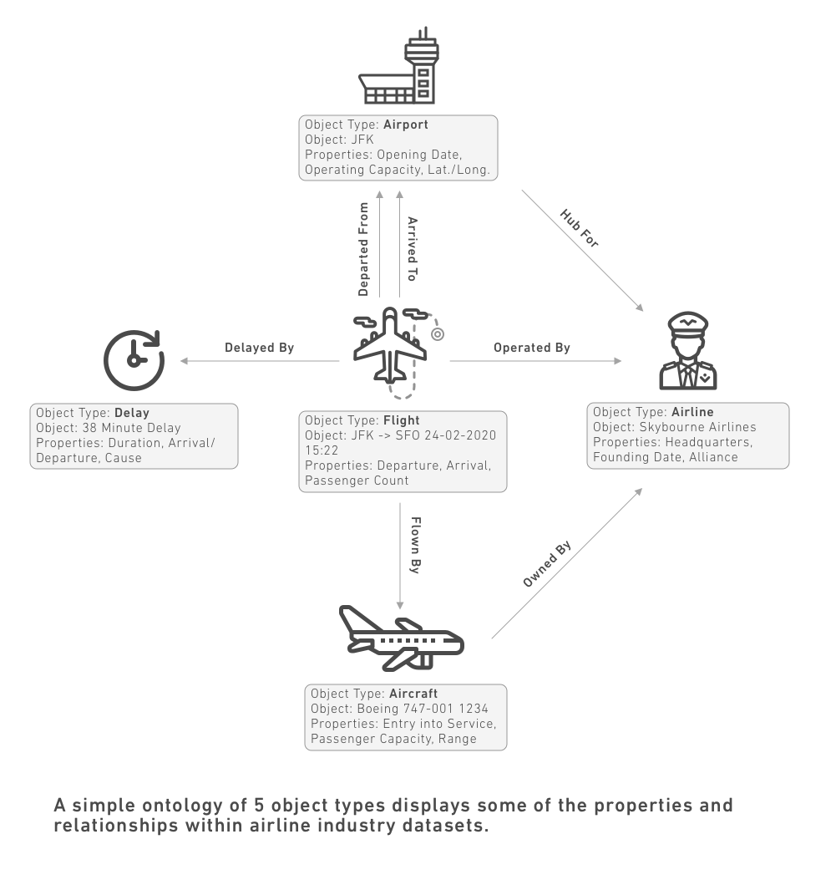

:::callout{theme="warning"}
注意：以下翻译的准确性尚未经过验证。这是使用 [AIP ↗](https://www.palantir.com/platforms/aip/) 从原始英文文本进行的机器翻译。
:::

# 核心概念

本页面描述了Foundry中与Ontology相关的主要概念。

## Ontology

Ontology是对世界的分类。在Foundry中，Ontology是组织的数字孪生体，是一个丰富的语义层，位于集成到Foundry中的数字资产（数据集和模型）之上。Foundry Ontology通过将数据集和模型映射到Object类型、属性、链接类型和操作类型，创建了一个组织世界的完整图景。

* [Object类型](#object-type)定义了组织中的一个实体或事件。
* [属性](#property)定义了Object类型的特征。
* [链接类型](#link-type)定义了两个Object类型之间的关系。
* [操作类型](#action-type)定义了如何修改Object类型。

构成Ontology的概念在数据集的结构中有相似之处。您可以将每个Object类型看作类似于一个数据集；一个Object是一个Object类型的实例，就像一行是一个数据集中的一个条目。数据集中的列类似于Object的属性，因为它们为给定的行提供了附加信息。数据集字段中的值（如电子表格中的单元格）类似于Object的属性值。并且，就像数据集可以通过各种方式合并在一起一样，对象可以基于属性值之间有链接。下表总结了这种比较：

|数据集   |Ontology         |
|---    |---            |
|数据集   |Object类型        |
|行      |Object           |
|列      |属性             |
|字段    |属性值           |
|合并    |链接类型         |

下图展示了这些概念如何结合在一起以创建一个Ontology。下面的内容继续更深入地定义Ontology的不同组件。

## Object类型

**Object类型**是一个真实世界实体或事件的模式定义。一个**Object**指的是一个Object类型的单个实例；一个Object对应于一个真实世界的实体或事件。一个**对象集**指的是多个Object实例的集合；即对象集代表了一组真实世界的实体或事件。

[了解更多关于Object类型的信息。](%E5%AE%9A%E4%B9%89%E6%9C%AC%E4%BD%93/%E5%AF%B9%E8%B1%A1%E9%93%BE%E6%8E%A5%E7%B1%BB%E5%9E%8B/Object%20types/%E6%A6%82%E8%A7%88.md)

## 属性

一个Object类型的**属性**是一个真实世界实体或事件特征的模式定义。一个**属性值**指的是Object上属性的值，或该真实世界实体或事件的单个实例。

[了解更多关于属性的信息。](%E5%AE%9A%E4%B9%89%E6%9C%AC%E4%BD%93/%E5%AF%B9%E8%B1%A1%E9%93%BE%E6%8E%A5%E7%B1%BB%E5%9E%8B/Properties/%E6%A6%82%E8%A7%88.md)

## 共享属性

**共享属性**是可以在Ontology中的多个Object类型上使用的属性。共享属性允许在Object类型之间进行一致的数据建模和属性元数据的集中管理。

[了解更多关于共享属性的信息。](%E5%AE%9A%E4%B9%89%E6%9C%AC%E4%BD%93/%E5%AF%B9%E8%B1%A1%E9%93%BE%E6%8E%A5%E7%B1%BB%E5%9E%8B/Shared%20properties/%E6%A6%82%E8%BF%B0.md)

## 链接类型

**链接类型**是两个Object类型之间关系的模式定义。一个**链接**指的是两个Object之间该关系的单个实例。

[了解更多关于链接类型的信息。](%E5%AE%9A%E4%B9%89%E6%9C%AC%E4%BD%93/%E5%AF%B9%E8%B1%A1%E9%93%BE%E6%8E%A5%E7%B1%BB%E5%9E%8B/Link%20types/%E6%A6%82%E8%BF%B0.md)

## 操作类型

**操作类型**是对Object、属性值和链接进行一组更改或编辑的模式定义，用户可以一次执行。它还包括操作提交时发生的副作用行为。一旦在Ontology中配置了操作类型，终端用户可以通过应用操作来更改Object。

[了解更多关于操作类型的信息。](%E5%AE%9A%E4%B9%89%E6%9C%AC%E4%BD%93/%E5%8A%A8%E4%BD%9C%E7%B1%BB%E5%9E%8B/%E6%A6%82%E8%BF%B0.md)

## 角色

**角色**是Ontology中的中心权限模型。类似于Foundry文件系统中的角色，Ontology角色授予对Ontology资源的访问权限。角色可以在Ontology级别或单个资源级别授予。

了解更多关于[Ontology角色](%E5%AE%9A%E4%B9%89%E6%9C%AC%E4%BD%93/%E6%9C%AC%E4%BD%93/%E6%9D%83%E9%99%90.md)的信息，以及它们如何用于Object类型、链接类型和操作类型。

## 函数

**函数**是一段基于代码的逻辑，接受输入参数并返回输出。函数与Ontology本地集成：它们可以接受Object和对象集作为输入，读取Object的属性值，并可用于建立在Ontology上的操作类型和应用程序中。

[了解更多关于函数的信息](%E5%AE%9A%E4%B9%89%E6%9C%AC%E4%BD%93/%E5%87%BD%E6%95%B0/%E6%A6%82%E8%BF%B0.md)，或[了解更多关于基于Ontology的函数](%E5%AE%9A%E4%B9%89%E6%9C%AC%E4%BD%93/%E5%87%BD%E6%95%B0/Functions%20on%20objects/%E6%A6%82%E8%BF%B0.md)。

## 接口

**接口**是描述Object类型及其功能的Ontology类型。接口提供Object类型的多态性，允许对具有共同形状的Object类型进行一致的建模和交互。

了解更多关于[接口](%E5%AE%9A%E4%B9%89%E6%9C%AC%E4%BD%93/%E6%8E%A5%E5%8F%A3/%E6%A6%82%E8%BF%B0.md)的信息。

## Object视图

**Object视图**是与特定Object相关的所有信息和工作流的中心枢纽。这包括关于一个Object的关键信息、任何链接的Object和相关指标，以及与该Object相关的分析、仪表盘和应用程序。

[了解更多关于Object视图的信息。](%E5%BA%94%E7%94%A8/%E5%AF%B9%E8%B1%A1%E8%A7%86%E5%9B%BE/%E6%A6%82%E8%A7%88.md)
