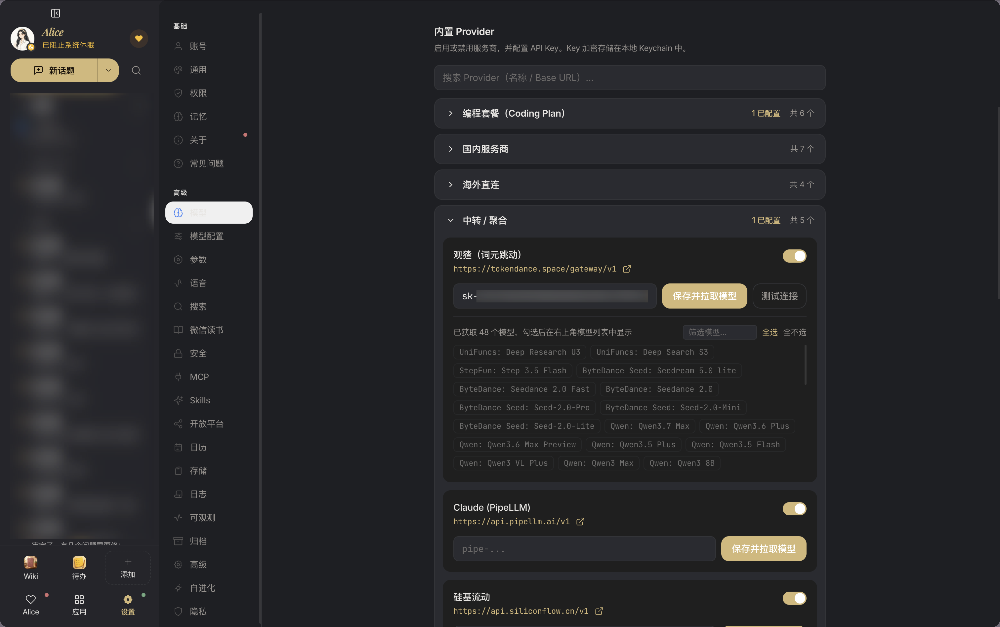
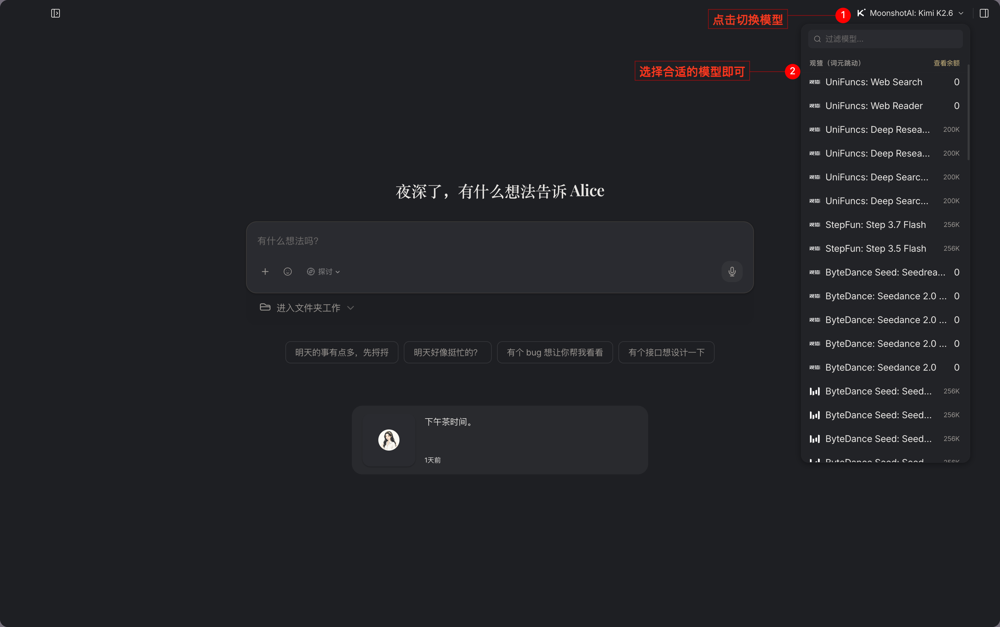

# Alice

[Alice](https://watcha.cn/products/alice?ref=tokendance-docs) 是一款 AI 搭子，主打「越协作，越着迷」，支持记事、任务执行与陪伴。配置词元跳动后，即可在 Alice 中调用词元跳动上支持 OpenAI 协议的模型，费用从词元跳动额度扣除，所有请求记录在 [调用日志](https://tokendance.space/activity) 中。

更多信息请访问 [观猹产品主页](https://watcha.cn/products/alice?ref=tokendance-docs)。

## 配置 {#configuration}

1. 进入 Alice 的**设置 → 模型 → 中转聚合**，选择 **词元跳动**，填入你的词元跳动 API Key。

   :::images
   
   :::

2. 按需在模型列表中启用你想使用的模型，也可以一键全选。

   :::images
   
   :::

3. 返回对话界面，点击右上角切换模型，选择任意已启用的词元跳动模型即可开始对话。

   :::images
   
   :::

::: note
模型 ID 以词元跳动 [模型列表](https://tokendance.space/models) 中的为准，且需支持 OpenAI 协议。词元跳动已内置在 Alice 的中转聚合列表中，无需手动填写 Base URL；若后续版本要求自定义，请填写 `https://tokendance.space/gateway/v1`。
:::

## 常见问题 {#troubleshooting}

- **鉴权失败**：检查 API Key 是否正确，且未过期。
- **模型不存在**：确认模型 ID 在词元跳动模型列表中存在且支持 OpenAI 协议；可在模型设置中重新拉取列表。
- **无法切换模型**：确保已在模型列表中启用该模型，且当前会话支持切换。

## 相关文档 {#related}

- [多协议支持](../../%E6%A8%A1%E5%9E%8B%E4%B8%8E%E5%8D%8F%E8%AE%AE/%E9%80%9A%E7%94%A8%E6%A8%A1%E5%9E%8B%E5%8D%8F%E8%AE%AE/OpenAI/OpenAI%20Chat%20Completions.md) — OpenAI 协议详情
- [API 密钥](../../%E5%BC%80%E5%A7%8B%E4%BD%BF%E7%94%A8/%E8%AE%BF%E9%97%AE%E4%B8%8E%E8%AE%A4%E8%AF%81/API%20%E5%AF%86%E9%92%A5.md) — 创建和管理密钥
- [模型](https://tokendance.space/models) — 查看支持 OpenAI 协议的模型
