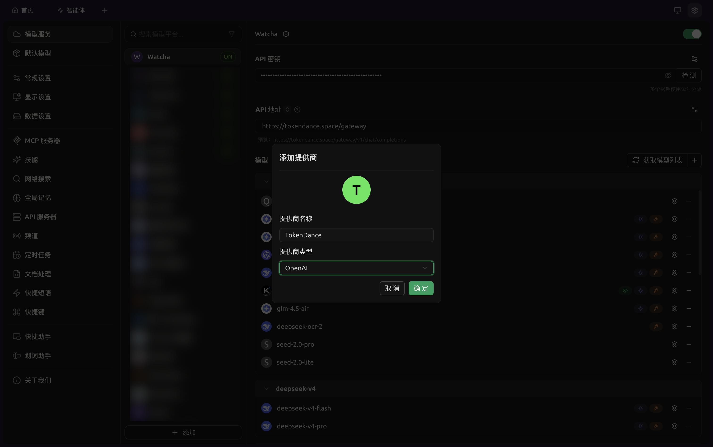
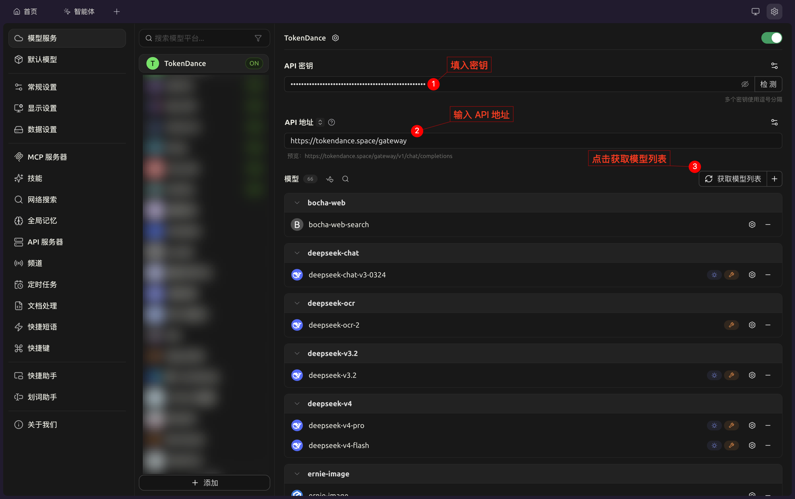
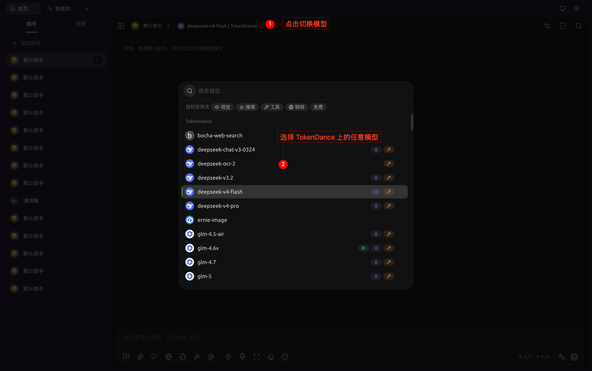

# Cherry Studio

[Cherry Studio](https://watcha.cn/products/cherry-studio?ref=tokendance-docs) 是一款跨平台桌面 LLM 客户端，支持手动添加任意 OpenAI 兼容的模型服务商。通过将 Cherry Studio 指向词元跳动，你就可以使用词元跳动上支持 OpenAI 协议的模型来驱动它，费用从词元跳动额度扣除，所有请求记录在 [调用日志](https://tokendance.space/activity) 中。

更多信息请访问 [观猹产品主页](https://watcha.cn/products/cherry-studio?ref=tokendance-docs)。

## 配置 {#configuration}

1. 打开 **设置 → 模型服务**，在列表底部点击 **+ 添加**。

   

2. 提供商类型选择 **OpenAI**，填写名称（如「词元跳动」），点击添加。
3. 进入配置页填写：
   - **API 密钥**：你的词元跳动 API Key
   - **API 地址**：`https://tokendance.space/gateway`
4. 打开右上角开关启用该服务商。
5. 点击「管理 / 获取模型」自动拉取，或手动填入词元跳动上的模型 ID（如 `deepseek-v4-flash-0731`）。
6. 点击密钥旁的「检测」验证连通性。

   

7. 在对话界面切换模型。

   

::: note
模型 ID 以词元跳动 [模型列表](https://tokendance.space/models) 中的为准，且需支持 OpenAI 协议。API 密钥支持填多个（用英文逗号分隔）以轮询使用。
:::

## 常见问题 {#troubleshooting}

- **404 / 路径错误**：检查 API 地址是否填写正确，避免 `/v1` 被重复拼接。
- **检测失败**：确认密钥正确、所选模型支持 OpenAI 协议。
- **模型列表为空**：可手动填入模型 ID，不依赖自动拉取。

## 相关文档 {#related}

- [多协议支持](../../%E6%A8%A1%E5%9E%8B%E4%B8%8E%E5%8D%8F%E8%AE%AE/%E9%80%9A%E7%94%A8%E6%A8%A1%E5%9E%8B%E5%8D%8F%E8%AE%AE/OpenAI/OpenAI%20Chat%20Completions.md) — OpenAI 协议详情
- [API 密钥](../../%E5%BC%80%E5%A7%8B%E4%BD%BF%E7%94%A8/%E8%AE%BF%E9%97%AE%E4%B8%8E%E8%AE%A4%E8%AF%81/API%20%E5%AF%86%E9%92%A5.md) — 创建和管理密钥
- [模型](https://tokendance.space/models) — 查看支持 OpenAI 协议的模型
