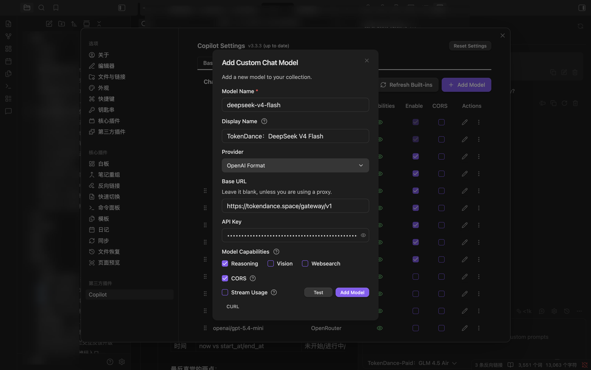
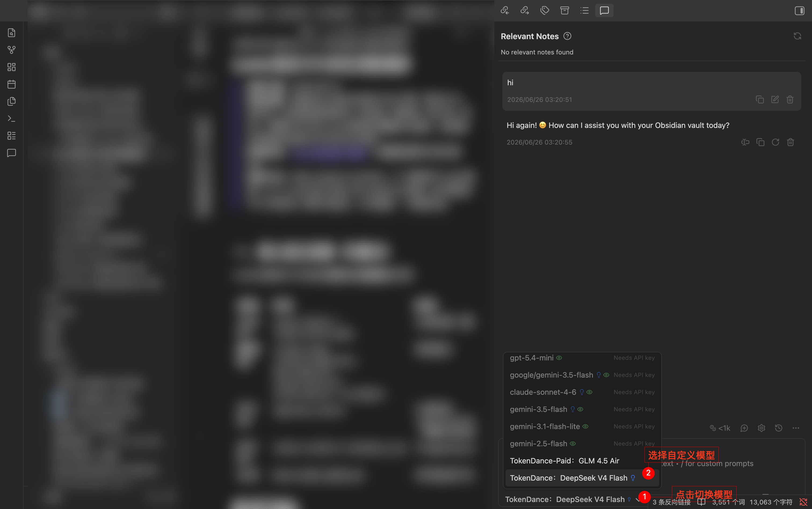
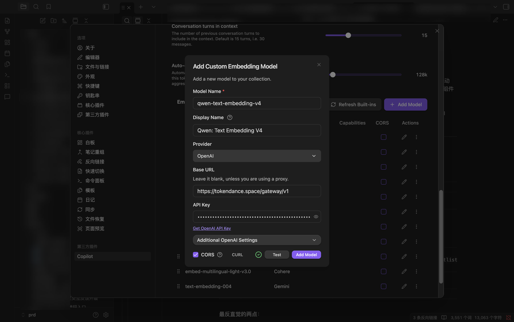

# Obsidian

[Obsidian](https://obsidian.md) 是流行的本地优先笔记软件，通过社区 AI 插件可接入大模型。其中 [Copilot for Obsidian](https://github.com/logancyang/obsidian-copilot) 内置「3rd party (openai format)」供应商类型，是接入 OpenAI 兼容端点最直接的选择。通过将 Obsidian Copilot 指向词元跳动，你就可以使用词元跳动上支持 OpenAI 协议的模型来驱动它，费用从词元跳动额度扣除，所有请求记录在 [调用日志](https://tokendance.space/activity) 中。

## 安装插件 {#install}

进入 **Settings → Community Plugins**（设置 → 社区插件），搜索 **Copilot** 并安装、启用。

## 配置 {#configuration}

1. 打开 **Copilot Settings → Model**（模型）标签页。
2. 点击 **Add Custom Model**（添加自定义模型），填写：

| 字段 | 填写内容 |
|---|---|
| Model Name | 词元跳动上的模型 ID，如 `deepseek-v4-flash-0731` |
| Provider | 选择 **3rd party (openai format)** |
| Base URL | `https://tokendance.space/gateway/v1` |
| API Key | 你的词元跳动 API Key |

3. 在 **Model Capabilities** 中按需开启 CORS 等能力，其余选项根据模型实际情况开启。

   

4. 点击 **Add Model** 保存，在聊天界面的模型下拉中选用。

   

::: note
插件会在 Base URL 后自动追加 `/chat/completions`，填到 `/v1` 即可。Vault QA / RAG 功能需另外配置一个 embedding 模型（需词元跳动暴露 OpenAI 兼容 `/embeddings`）。模型 ID 以词元跳动 [模型列表](https://tokendance.space/models) 中的为准。
:::

::: warning
若遇到 CORS 报错，可在表单中勾选 CORS 选项；但开启 CORS 模式后将不支持流式输出。排错时可打开开发者控制台（Cmd/Ctrl+Shift+I）查看具体错误。
:::

## 常见问题 {#troubleshooting}

- **404**：检查 Base URL 是否为 `https://tokendance.space/gateway/v1`，不要重复或缺失 `/v1`。
- **CORS 错误**：勾选插件的 CORS 选项（会失去流式输出）。
- **模型不存在**：确认模型 ID 在词元跳动模型列表中存在且支持 OpenAI 协议。

## 相关文档 {#related}

- [多协议支持](../../%E6%A8%A1%E5%9E%8B%E4%B8%8E%E5%8D%8F%E8%AE%AE/%E9%80%9A%E7%94%A8%E6%A8%A1%E5%9E%8B%E5%8D%8F%E8%AE%AE/OpenAI/OpenAI%20Chat%20Completions.md) — OpenAI 协议详情
- [API 密钥](../../%E5%BC%80%E5%A7%8B%E4%BD%BF%E7%94%A8/%E8%AE%BF%E9%97%AE%E4%B8%8E%E8%AE%A4%E8%AF%81/API%20%E5%AF%86%E9%92%A5.md) — 创建和管理密钥
- [模型](https://tokendance.space/models) — 查看支持 OpenAI 协议的模型
