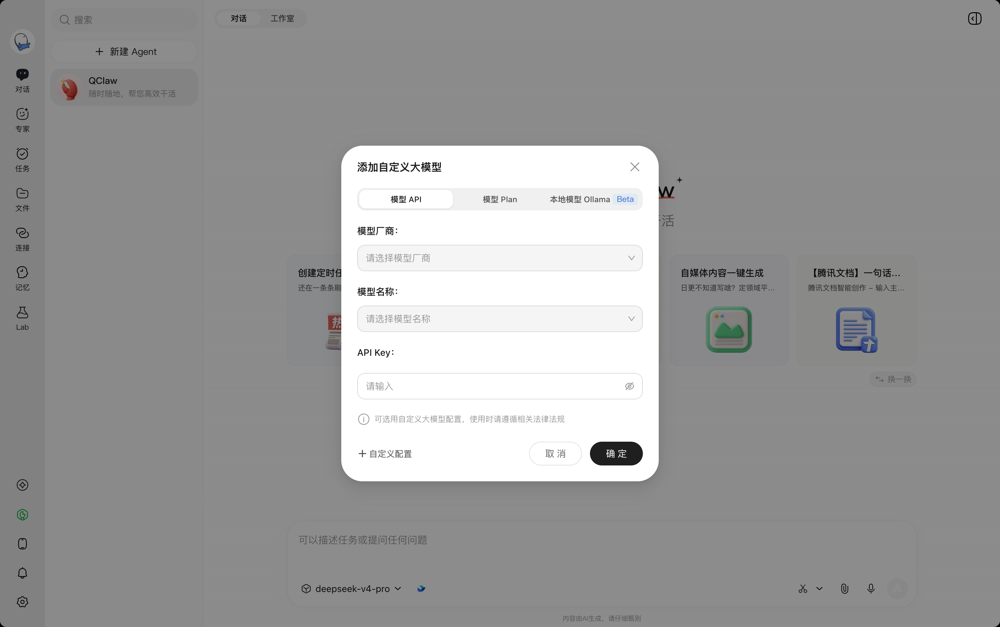
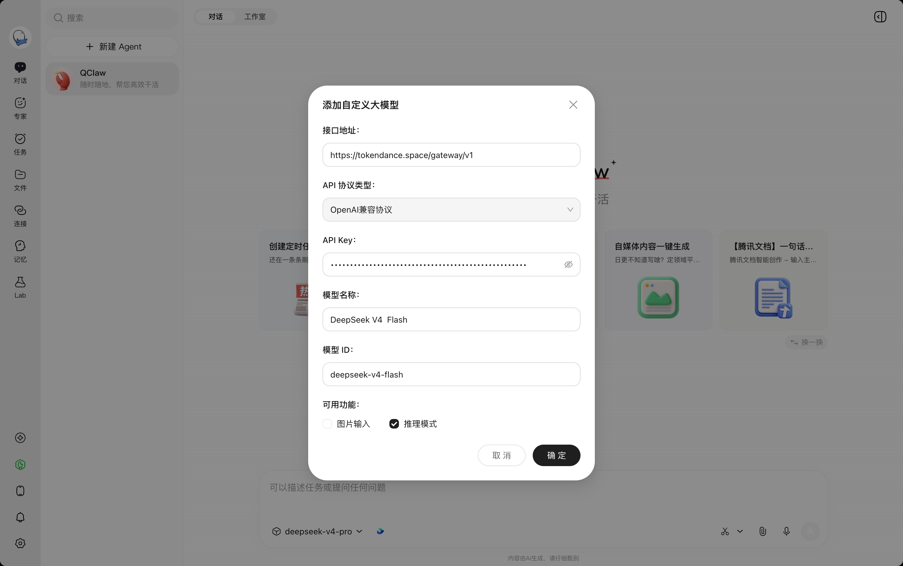
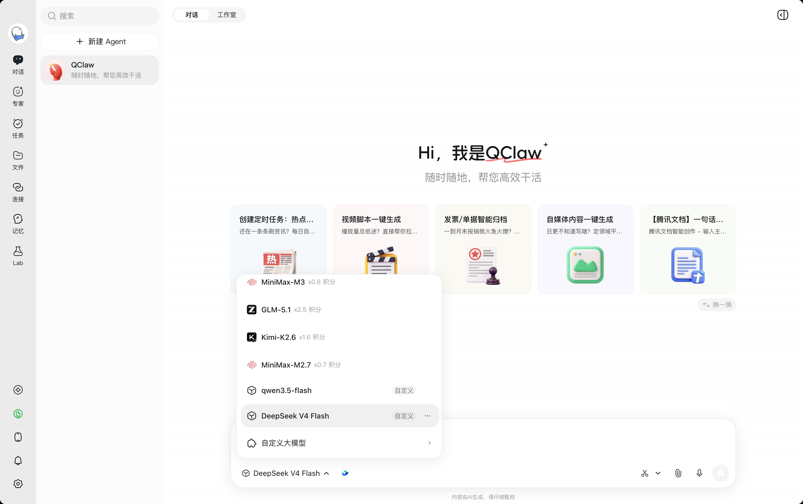

# QClaw

[QClaw](https://watcha.cn/products/qclaw?ref=tokendance-docs) 是腾讯电脑管家官方出品的桌面端 Agent 效率工具，支持 Mac 与 Windows 双平台一键部署。配置词元跳动后，即可在 QClaw 中调用词元跳动上支持 OpenAI 协议的模型，费用从词元跳动额度扣除，所有请求记录在 [调用日志](https://tokendance.space/activity) 中。更多信息请访问 [观猹产品主页](https://watcha.cn/products/qclaw?ref=tokendance-docs)。

## 配置 {#configuration}

1. 打开 QClaw，点击**选择模型**，进入模型管理页后选择**添加自定义大模型**，再点击左下角的**自定义配置**。

   :::images
   
   :::

2. 在自定义配置中填写：
   - **API 地址 / Base URL**：`https://tokendance.space/gateway/v1`
   - **API Key**：你的词元跳动 API Key
   - **模型 ID**：词元跳动上的模型 ID，如 `deepseek-v4-flash-0731`

   :::images
   
   :::

3. 保存后，回到模型选择器，选中刚添加的自定义大模型即可使用。

   :::images
   
   :::

::: note
模型 ID 以词元跳动 [模型列表](https://tokendance.space/models) 中的为准，且需支持 OpenAI 协议。Base URL 需保留 `/v1`，无多余结尾斜杠。
:::

## 常见问题 {#troubleshooting}

- **404 / 路径错误**：检查 Base URL 是否为 `https://tokendance.space/gateway/v1`（含 `/v1`，不要填到 `/chat/completions`）。
- **鉴权失败**：确认 API Key 正确，且没有误填到其他供应商配置中。
- **模型不存在**：模型 ID 需与词元跳动模型列表中的 ID 一致，且支持 OpenAI 协议。

## 相关文档 {#related}

- [多协议支持](../../%E6%A8%A1%E5%9E%8B%E4%B8%8E%E5%8D%8F%E8%AE%AE/%E9%80%9A%E7%94%A8%E6%A8%A1%E5%9E%8B%E5%8D%8F%E8%AE%AE/OpenAI/OpenAI%20Chat%20Completions.md) — OpenAI 协议详情
- [API 密钥](../../%E5%BC%80%E5%A7%8B%E4%BD%BF%E7%94%A8/%E8%AE%BF%E9%97%AE%E4%B8%8E%E8%AE%A4%E8%AF%81/API%20%E5%AF%86%E9%92%A5.md) — 创建和管理密钥
- [模型](https://tokendance.space/models) — 查看支持 OpenAI 协议的模型
