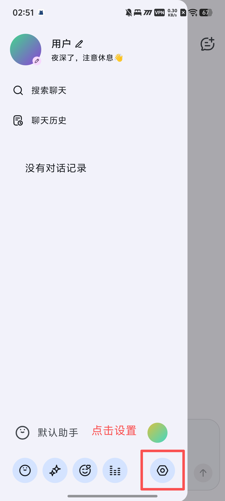
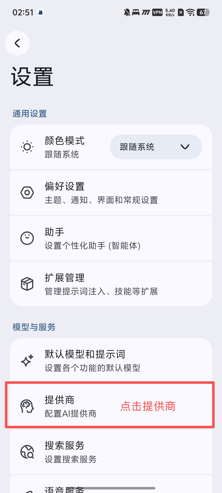
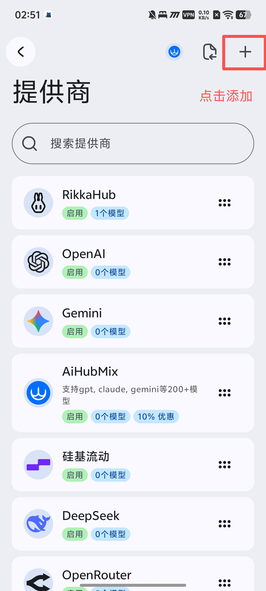
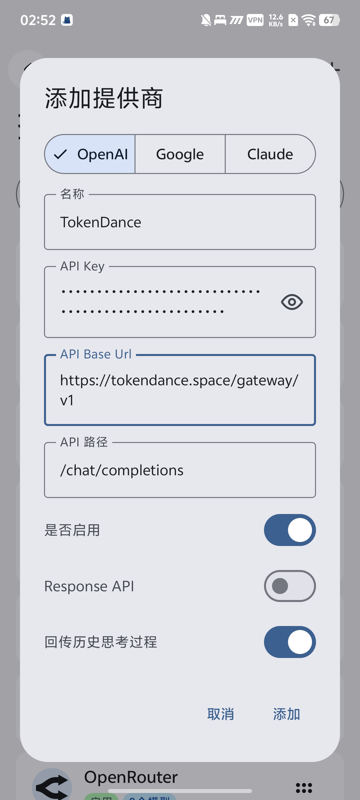
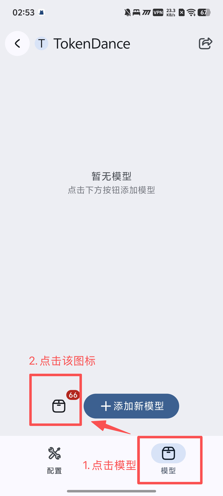
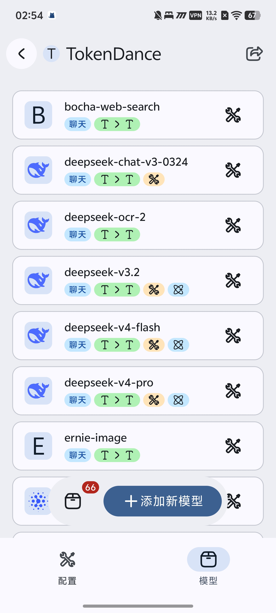
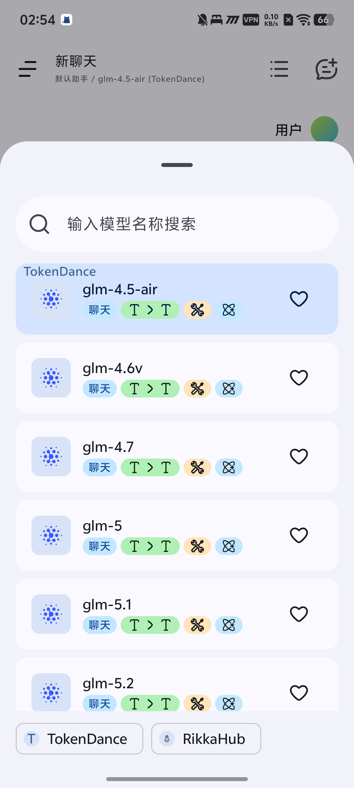

# RikkaHub

[RikkaHub](https://watcha.cn/products/rikkahub-desktop?ref=tokendance-docs) 是一款 Android 上的开源原生 LLM 聊天客户端，支持添加多个自定义供应商。通过将 RikkaHub 指向词元跳动，你就可以使用词元跳动上支持 OpenAI 协议的模型来驱动它，费用从词元跳动额度扣除，所有请求记录在 [调用日志](https://tokendance.space/activity) 中。

更多信息请访问 [观猹产品主页](https://watcha.cn/products/rikkahub-desktop?ref=tokendance-docs)。

## 配置 {#configuration}

1. 进入 **Settings → Providers**（设置 → 供应商），点击 **Add Provider**（添加供应商）。

   :::images
   
   
   
   :::

2. 供应商类型选择 **OpenAI**。
3. 将 **Base URL** 由默认的 `https://api.openai.com/v1` 改为：

   ```text
   https://tokendance.space/gateway/v1
   ```

4. 填入 **API Key**（你的词元跳动 API Key）。

   

5. 再次点击进入供应商配置界面，切换到「模型」Tab，点击如图所示的图标即可添加全部模型。

   :::images
   
   
   :::

6. 回到对话界面，启用 TokenDance 模型即可。

   

::: note
Base URL 需保留 `/v1`。模型 ID 以词元跳动 [模型列表](https://tokendance.space/models) 中的为准，且需支持 OpenAI 协议。
:::

## 常见问题 {#troubleshooting}

- **404**：检查 Base URL 是否为 `https://tokendance.space/gateway/v1`（含 `/v1`，无重复、无多余结尾斜杠）。
- **model not found**：确认填入的模型 ID 在词元跳动模型列表中存在且支持 OpenAI 协议。
- **鉴权失败**：检查 API Key 是否正确。
- **标题总结失败**：可在「设置 → 默认模型和提示词」中指定标题总结模型。

## 相关文档 {#related}

- [多协议支持](../../%E6%A8%A1%E5%9E%8B%E4%B8%8E%E5%8D%8F%E8%AE%AE/%E9%80%9A%E7%94%A8%E6%A8%A1%E5%9E%8B%E5%8D%8F%E8%AE%AE/OpenAI/OpenAI%20Chat%20Completions.md) — OpenAI 协议详情
- [API 密钥](../../%E5%BC%80%E5%A7%8B%E4%BD%BF%E7%94%A8/%E8%AE%BF%E9%97%AE%E4%B8%8E%E8%AE%A4%E8%AF%81/API%20%E5%AF%86%E9%92%A5.md) — 创建和管理密钥
- [模型](https://tokendance.space/models) — 查看支持 OpenAI 协议的模型
