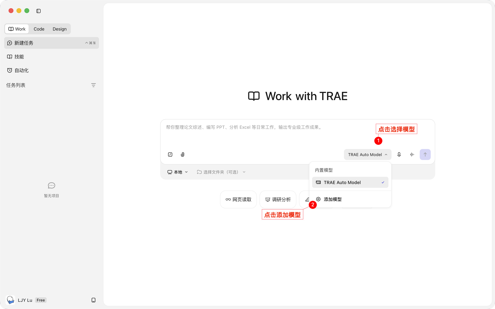
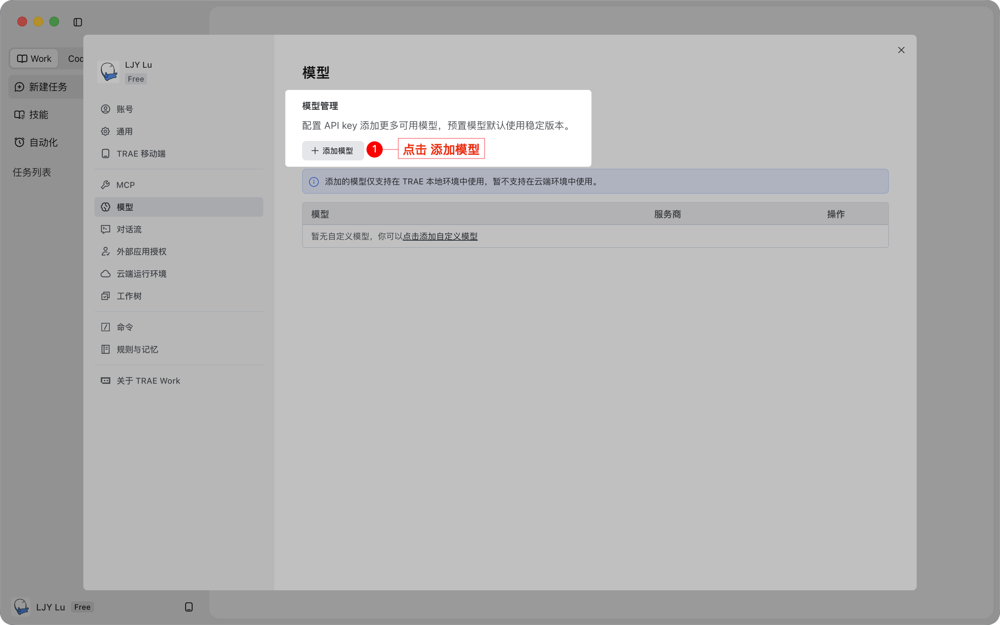
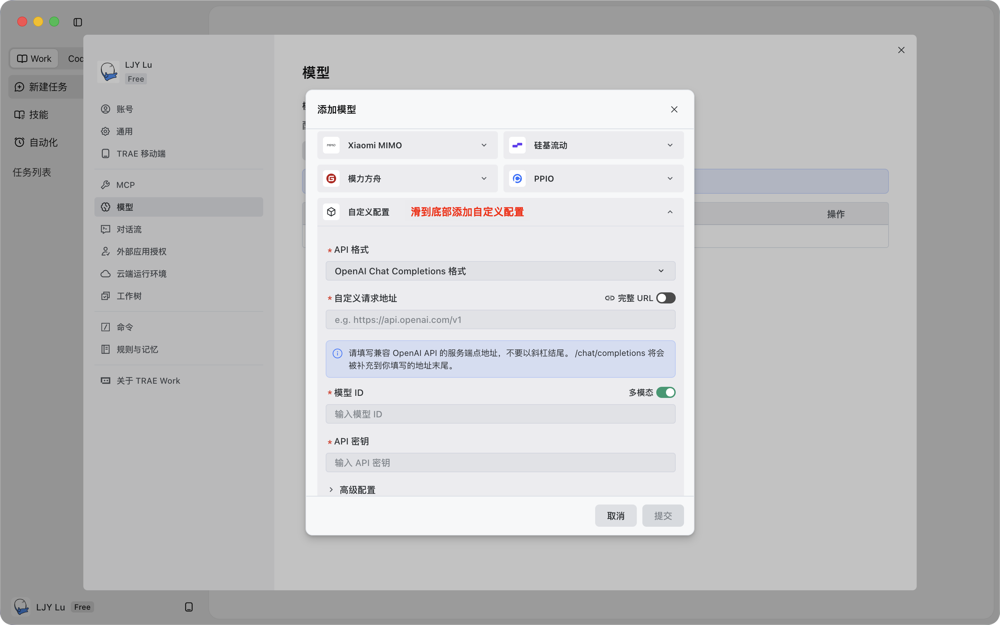
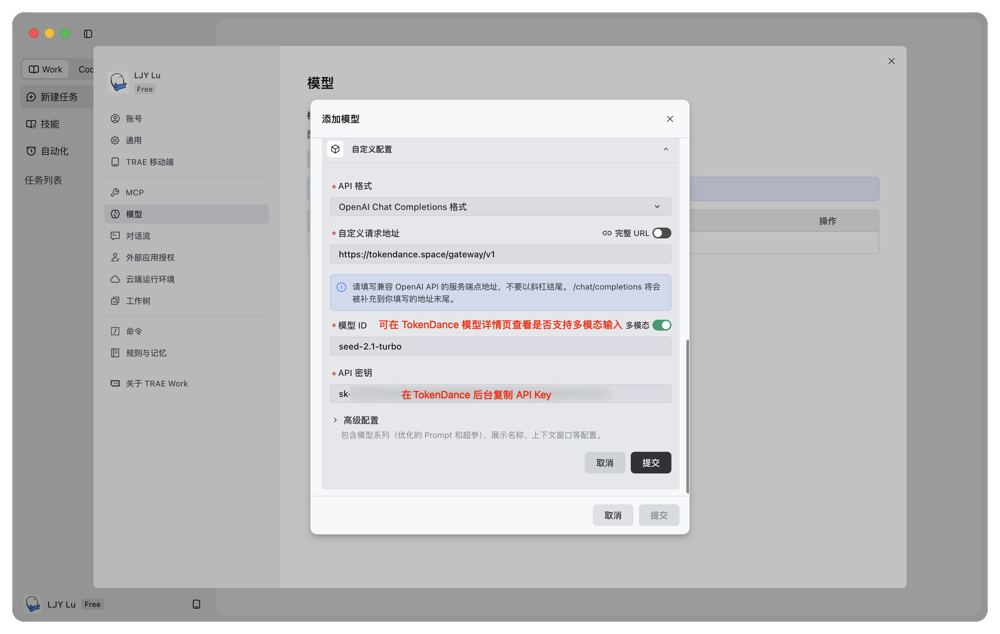
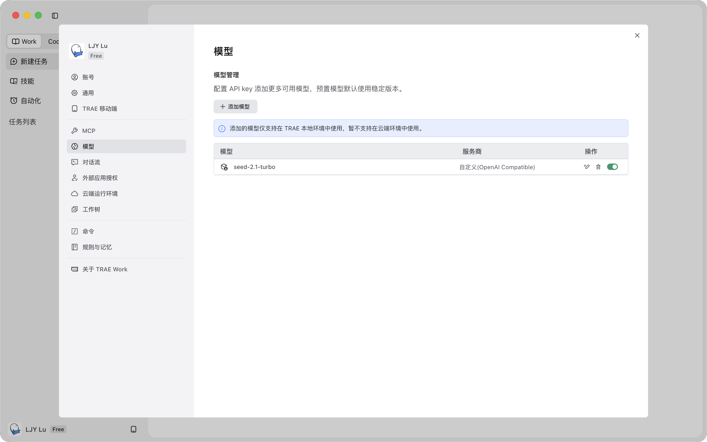
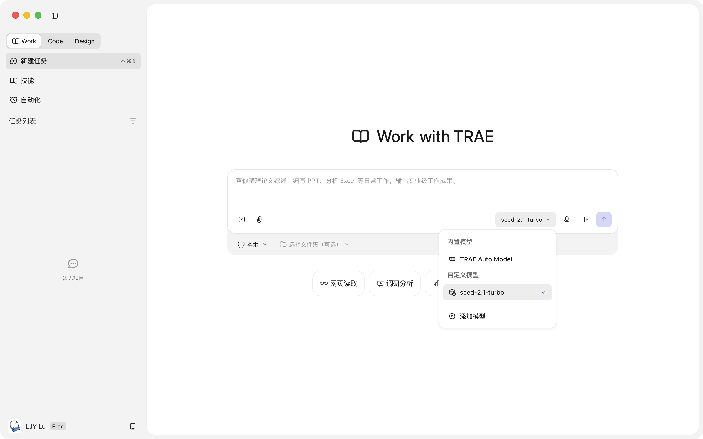

# TRAE Work

[TRAE Work](https://watcha.cn/products/trae-work?ref=tokendance-docs) 是 TRAE 推出的 AI 原生工作台，定位不再局限于写代码，而是把研究、分析、汇报、开发、内容生成等任务都交给 AI 来拆解和执行。配置词元跳动后即可在 TRAE Work 中调用词元跳动上的模型，费用从词元跳动额度扣除，所有请求记录在 [调用日志](https://tokendance.space/activity) 中。

更多信息请访问 [观猹产品主页](https://watcha.cn/products/trae-work?ref=tokendance-docs)。

## 配置 {#configuration}

1. 打开 TRAE Work，点击**模型配置**，进入模型管理页，下滑到底部点击**添加自定义配置**。

   :::images
   
   
   :::

2. 选择添加自定义配置后的入口。

   

3. 按模型需求填写接口信息：
   - **OpenAI Chat Completions 格式**：`https://tokendance.space/gateway/v1`
   - **Anthropic Messages 格式**：`https://tokendance.space/gateway/v1/messages`
   - **API Key**：你的词元跳动 API Key
   - **模型 ID**：词元跳动上的模型 ID，如 `deepseek-v4-flash-0731`

   :::images
   
   :::

4. 保存并启用该自定义模型。

   :::images
   
   
   :::

::: note
模型 ID 以词元跳动 [模型列表](https://tokendance.space/models) 中的为准，且需与所选接口协议匹配。OpenAI 协议模型使用 `/v1` 端点；Anthropic 协议模型按 TRAE Work 的要求填写到 `/v1/messages`。
:::

## 常见问题 {#troubleshooting}

- **模型管理列表中看不到新模型**：检查网络环境，或重启 TRAE Work 后重新进入模型管理页。
- **模型选择列表中看不到新模型**：尝试先关闭再启用该自定义模型。
- **404 / 路径错误**：OpenAI 格式填 `https://tokendance.space/gateway/v1`；Anthropic 格式按 TRAE Work 提示填到 `/v1/messages`，不要重复拼接路径。
- **鉴权失败**：确认 API Key 正确，且没有误填到其他供应商配置中。

## 相关文档 {#related}

- [多协议支持](../../%E6%A8%A1%E5%9E%8B%E4%B8%8E%E5%8D%8F%E8%AE%AE/%E9%80%89%E6%8B%A9%E6%A8%A1%E5%9E%8B%E4%B8%8E%E5%8D%8F%E8%AE%AE/%E5%8D%8F%E8%AE%AE%E6%80%BB%E8%A7%88.md) — OpenAI / Anthropic 协议详情
- [API 密钥](../../%E5%BC%80%E5%A7%8B%E4%BD%BF%E7%94%A8/%E8%AE%BF%E9%97%AE%E4%B8%8E%E8%AE%A4%E8%AF%81/API%20%E5%AF%86%E9%92%A5.md) — 创建和管理密钥
- [模型](https://tokendance.space/models) — 查看支持 OpenAI / Anthropic 协议的模型
