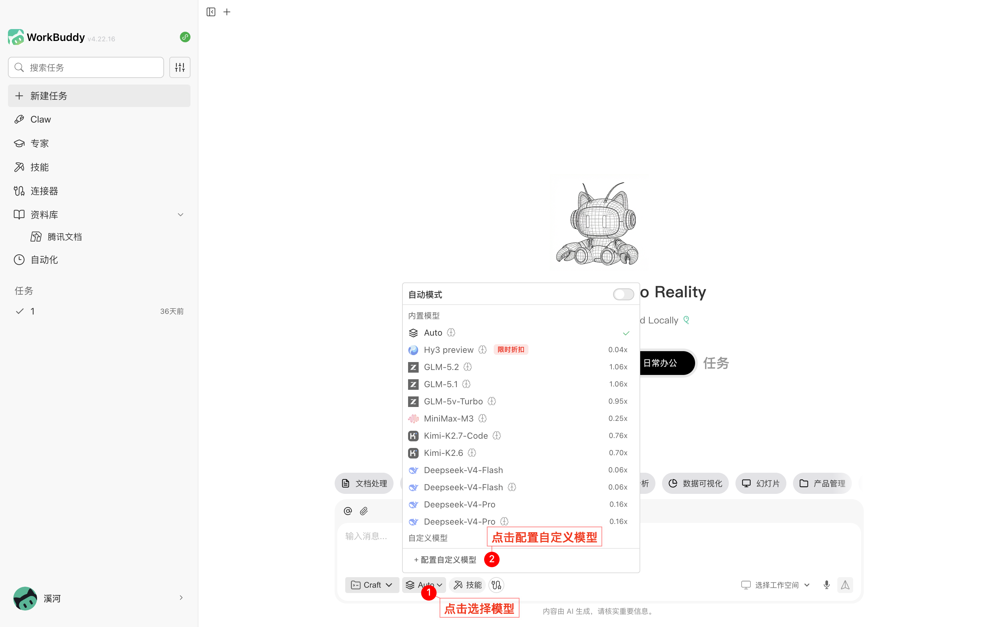
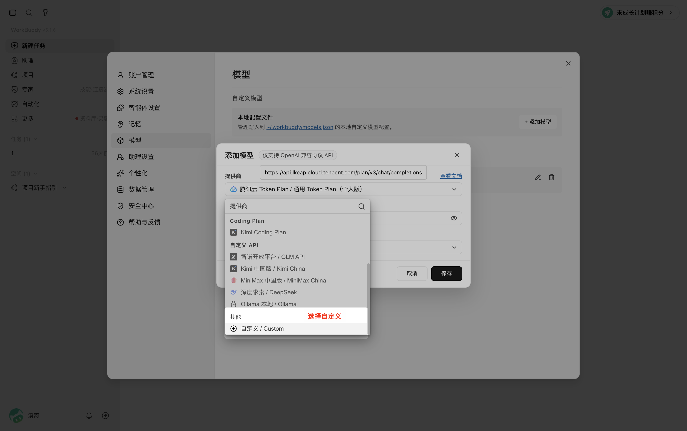
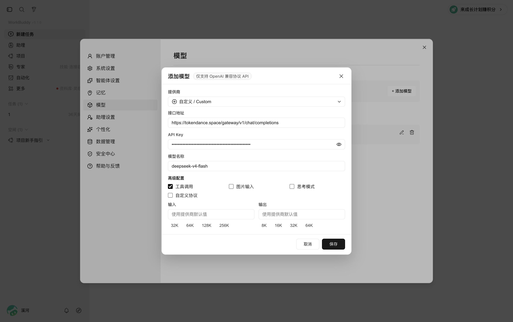
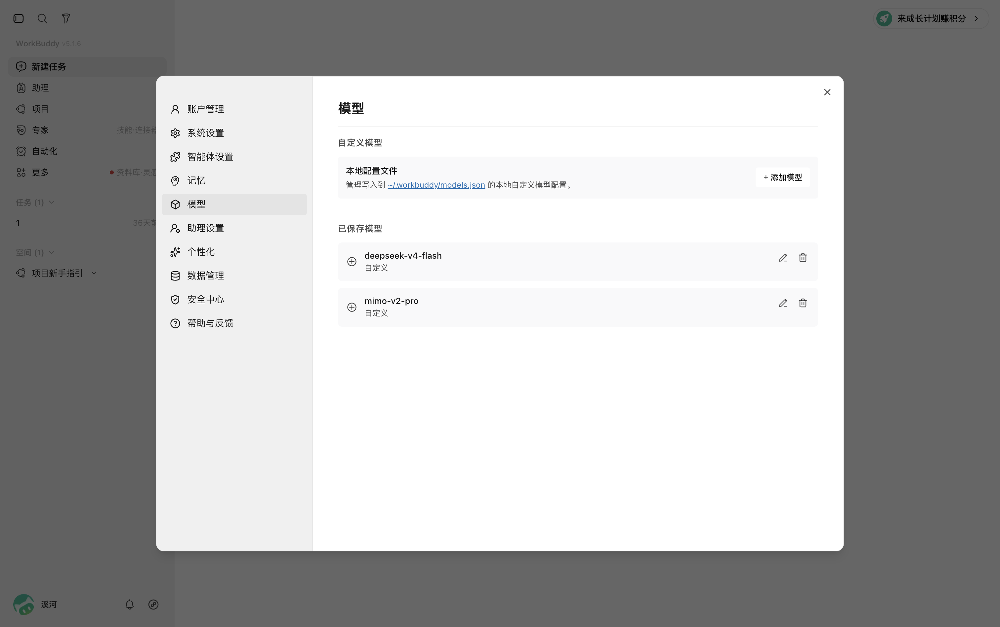
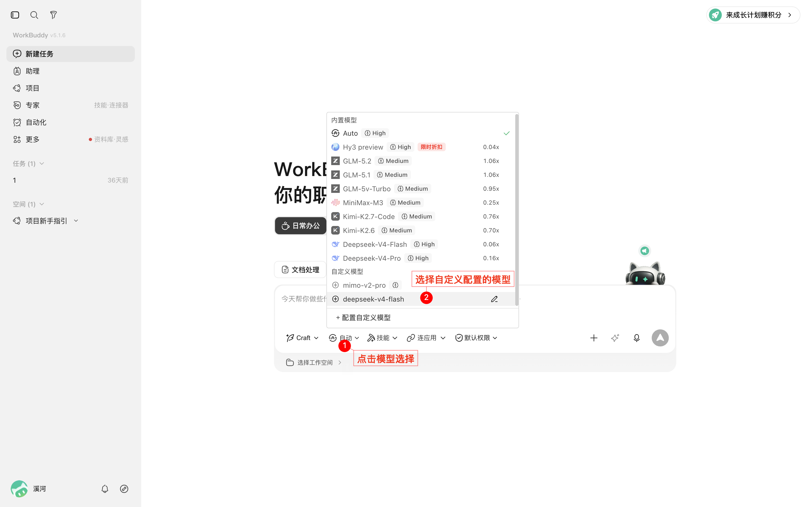

# Workbuddy 系列

[Workbuddy](https://watcha.cn/products/workbuddy?ref=tokendance-docs) 是 AI 原生的桌面智能体工作台，通过自然语言驱动办公自动化，支持多 Agent 并行完成多模态复杂任务。

[Codebuddy](https://watcha.cn/products/codebuddy-IDE?ref=tokendance-docs) 是基于混元代码大模型的辅助编码工具，支持代码补全、诊断与优化。

[LearnBuddy](https://watcha.cn/products/learnbuddy?ref=tokendance-docs) 则是面向学生、教师、科研人员及校园管理者的 AI 原生自主学习与知识沉淀工作台。

三款产品的模型配置方式相同，配置词元跳动后即可调用词元跳动上支持 OpenAI 协议的模型，费用从词元跳动额度扣除，所有请求记录在 [调用日志](https://tokendance.space/activity) 中。

## 配置 {#configuration}

本文以 Workbuddy 为例；Codebuddy 与 LearnBuddy 按相同路径配置即可。

1. 打开**模型配置**，进入模型管理页，下滑到底部点击**添加自定义配置**。

   :::images
   
   
   :::

2. 在自定义配置表单中填写：
   - **接口地址**：`https://tokendance.space/gateway/v1/chat/completions`
   - **API Key**：你的词元跳动 API Key
   - **模型 ID**：词元跳动上的模型 ID，如 `deepseek-v4-flash-0731`

   根据模型实际能力，按需勾选图片输入、思考模式等选项。

   :::images
   
   :::

3. 点击保存并启用该自定义模型。

   :::images
   
   
   :::

::: note
Workbuddy 的接口地址字段需要填写完整调用路径，因此示例中给到 `/v1/chat/completions`。

模型 ID 以词元跳动 [模型列表](https://tokendance.space/models) 中的为准，且需支持 OpenAI 协议。
:::

## 常见问题 {#troubleshooting}

- **404 / 路径错误**：检查接口地址是否重复拼接了 `/chat/completions`；若软件已自动追加该路径，则 Base URL 只填到 `/v1`。
- **鉴权失败**：确认 API Key 正确，且没有填错字段。
- **模型不存在**：模型 ID 需与词元跳动模型列表中的 ID 一致，且支持 OpenAI 协议。

## 相关文档 {#related}

- [多协议支持](../../%E6%A8%A1%E5%9E%8B%E4%B8%8E%E5%8D%8F%E8%AE%AE/%E9%80%9A%E7%94%A8%E6%A8%A1%E5%9E%8B%E5%8D%8F%E8%AE%AE/OpenAI/OpenAI%20Chat%20Completions.md) — OpenAI 协议详情
- [API 密钥](../../%E5%BC%80%E5%A7%8B%E4%BD%BF%E7%94%A8/%E8%AE%BF%E9%97%AE%E4%B8%8E%E8%AE%A4%E8%AF%81/API%20%E5%AF%86%E9%92%A5.md) — 创建和管理密钥
- [模型](https://tokendance.space/models) — 查看支持 OpenAI 协议的模型
