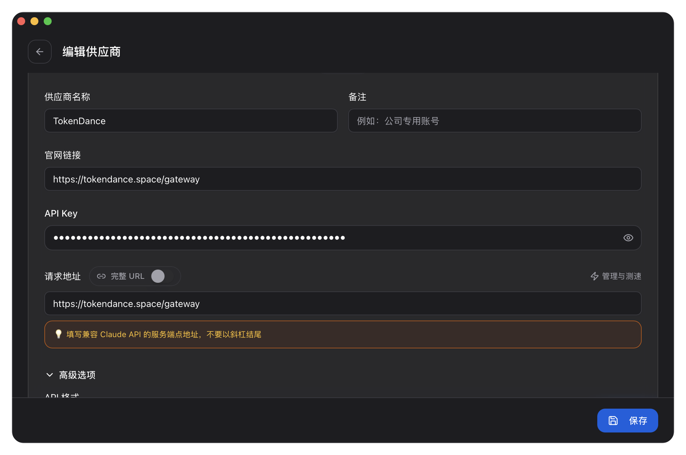
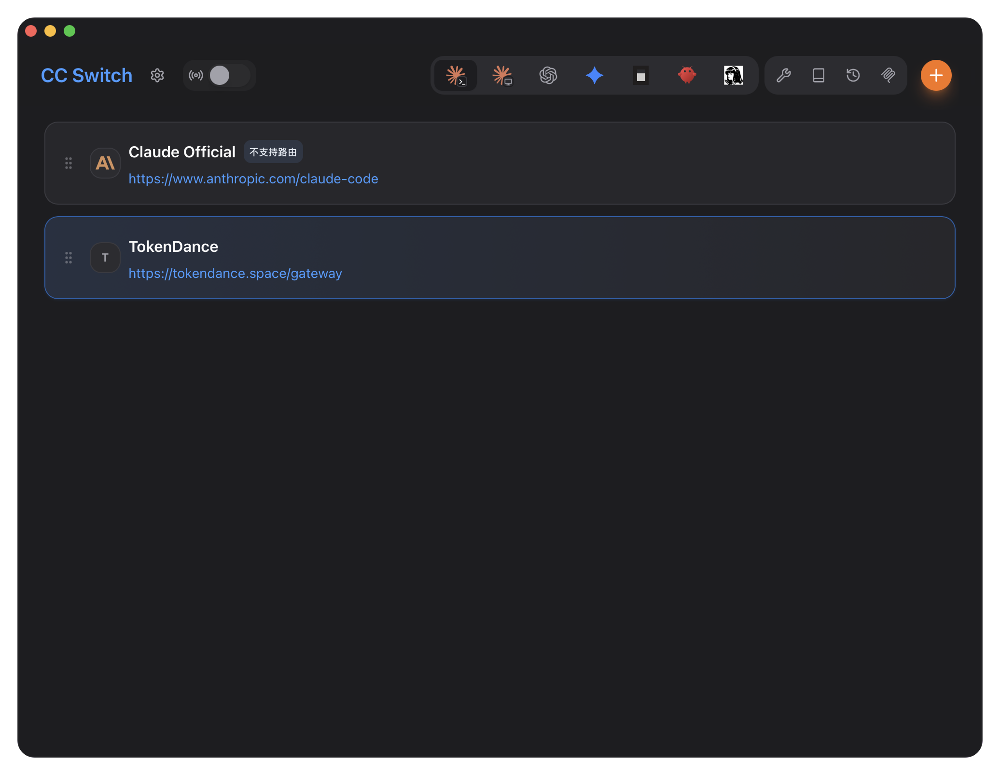

# CC-Switch

[CC-Switch](https://ccswitch.io) 是一款跨平台桌面工具，用于在多个供应商配置间一键切换，支持 Claude Code、Codex、OpenCode、OpenClaw、Gemini CLI、Hermes Agent 等。通过将 CC-Switch 指向词元跳动，你就可以使用词元跳动上支持 Anthropic / OpenAI 协议的模型来驱动它，费用从词元跳动额度扣除，所有请求记录在 [调用日志](https://tokendance.space/activity) 中。

## 工作原理 {#how-it-works}

CC-Switch 本质是帮你管理各 CLI 工具的配置文件 / 环境变量。切换到某供应商时，它会把对应的接口地址与密钥写入目标工具的配置（例如 Claude Code 的 `ANTHROPIC_BASE_URL` 与 `ANTHROPIC_AUTH_TOKEN`），免去手动改 JSON。

## 添加词元跳动供应商 {#add-provider}

### Claude Code / Codex 等 Anthropic 系工具

在 CC-Switch 中为 Claude Code 新增一个供应商配置，按下图填写：



保存并启用即可：



对应的环境变量为：

```bash title="Anthropic 协议"
ANTHROPIC_BASE_URL=https://tokendance.space/gateway
ANTHROPIC_AUTH_TOKEN=YOUR_KEY
```

### Codex

TokenDance 已支持 Responses API，Codex 可以直接连接词元跳动，不再依赖 CC-Switch 的本地路由。请参考 [Codex 接入教程](Codex.md) 完成配置。

::: note
具体填写界面以 CC-Switch 当前版本为准。词元跳动提供 Anthropic Messages、OpenAI Chat Completions 与 OpenAI Responses 等协议端点，按目标工具所走的协议选择对应地址即可。详见 [多协议支持](../../%E6%A8%A1%E5%9E%8B%E4%B8%8E%E5%8D%8F%E8%AE%AE/%E9%80%89%E6%8B%A9%E6%A8%A1%E5%9E%8B%E4%B8%8E%E5%8D%8F%E8%AE%AE/%E5%8D%8F%E8%AE%AE%E6%80%BB%E8%A7%88.md)。
:::

## 常见问题 {#troubleshooting}

- **切换后未生效**：部分工具需重启或重新加载配置后才会读取新的环境变量。
- **鉴权失败**：确认 Anthropic 端点用 `ANTHROPIC_AUTH_TOKEN`、OpenAI 端点用 `Authorization: Bearer`（密钥字段），且地址与协议匹配。
- **模型不可用**：所选模型需支持对应协议，详见词元跳动 [模型列表](https://tokendance.space/models)。

## 相关文档 {#related}

- [Claude Code](Claude%20Code.md) — 直接配置 Claude Code 的完整说明
- [Codex](Codex.md) — 通过 Responses API 直接接入词元跳动
- [多协议支持](../../%E6%A8%A1%E5%9E%8B%E4%B8%8E%E5%8D%8F%E8%AE%AE/%E9%80%89%E6%8B%A9%E6%A8%A1%E5%9E%8B%E4%B8%8E%E5%8D%8F%E8%AE%AE/%E5%8D%8F%E8%AE%AE%E6%80%BB%E8%A7%88.md) — Anthropic / OpenAI 协议详情
- [API 密钥](../../%E5%BC%80%E5%A7%8B%E4%BD%BF%E7%94%A8/%E8%AE%BF%E9%97%AE%E4%B8%8E%E8%AE%A4%E8%AF%81/API%20%E5%AF%86%E9%92%A5.md) — 创建和管理密钥
