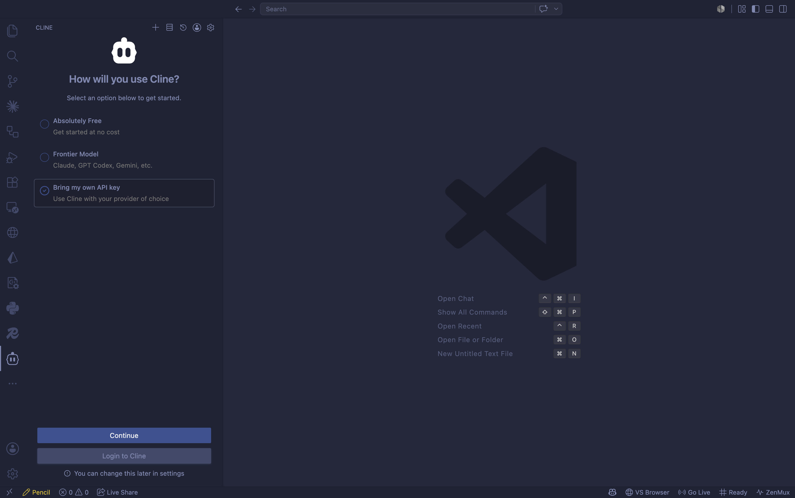
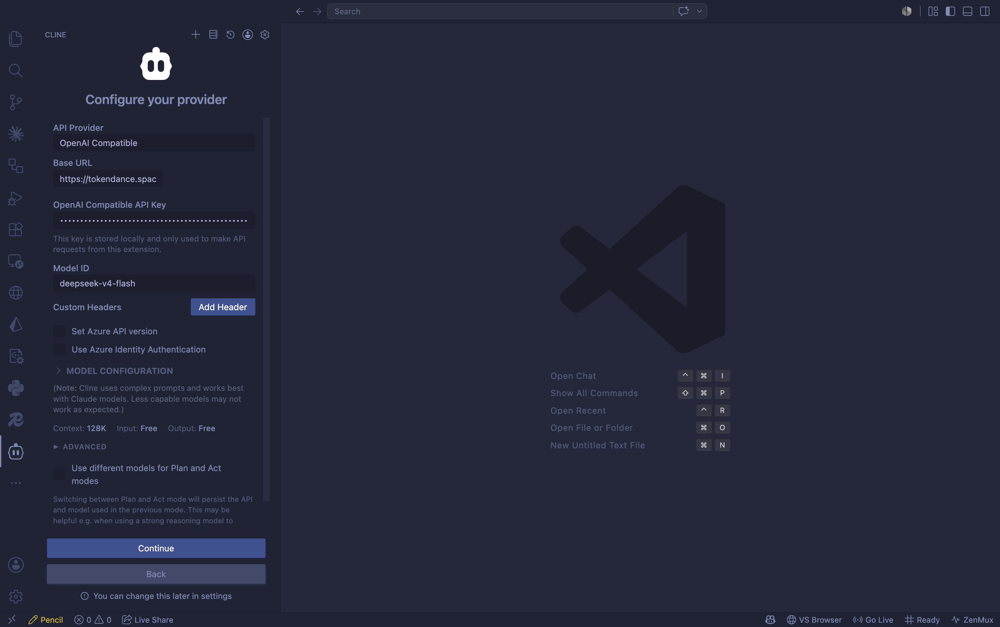

# Cline

[Cline](https://watcha.cn/products/cline?ref=tokendance-docs) 是 VS Code 上流行的开源 AI 编程助手（原 Claude Dev）。通过将 Cline 指向词元跳动，你就可以使用词元跳动上支持 OpenAI 协议的模型来驱动它，费用从词元跳动额度扣除，所有请求记录在 [调用日志](https://tokendance.space/activity) 中。

更多信息请访问 [观猹产品主页](https://watcha.cn/products/cline?ref=tokendance-docs)。

## 安装 Cline {#install}

在 VS Code 扩展市场搜索 **Cline** 并安装，或访问 [Cline 官网](https://cline.bot/install) 一键安装。

## 配置 {#configuration}

1. 点击侧边栏的 Cline 图标，再点设置（⚙️）图标进入配置。

   

2. **API Provider**（供应商）选择 **OpenAI Compatible**。
3. 按下表填写：

| 字段 | 填写内容 |
|---|---|
| Base URL | `https://tokendance.space/gateway/v1` |
| API Key | 你的词元跳动 API Key |
| Model ID | 词元跳动上的模型 ID，如 `deepseek-v4-flash-0731` |

   

4.（可选）在 **Model Configuration** 中按所选模型调整 Max Output Tokens、Context Window、图像支持等参数。
5. 保存后即可在对话中使用该模型。

::: note
Model ID 必须与词元跳动 [模型列表](https://tokendance.space/models) 中的一致，且该模型需支持 OpenAI 协议。不同模型的上下文窗口与最大输出长度不同，可在 Model Configuration 中按需调整。
:::

## 常见问题 {#troubleshooting}

- **Invalid API Key**：检查密钥是否填写正确、是否误填到其他供应商类型下。
- **Model Not Found**：确认 Model ID 在词元跳动模型列表中存在且支持 OpenAI 协议。
- **连接错误**：确认 Base URL 为 `https://tokendance.space/gateway/v1`，网络可正常访问该地址。

## 相关文档 {#related}

- [多协议支持](../../%E6%A8%A1%E5%9E%8B%E4%B8%8E%E5%8D%8F%E8%AE%AE/%E9%80%9A%E7%94%A8%E6%A8%A1%E5%9E%8B%E5%8D%8F%E8%AE%AE/OpenAI/OpenAI%20Chat%20Completions.md) — OpenAI 协议详情
- [API 密钥](../../%E5%BC%80%E5%A7%8B%E4%BD%BF%E7%94%A8/%E8%AE%BF%E9%97%AE%E4%B8%8E%E8%AE%A4%E8%AF%81/API%20%E5%AF%86%E9%92%A5.md) — 创建和管理密钥
- [模型](https://tokendance.space/models) — 查看支持 OpenAI 协议的模型
