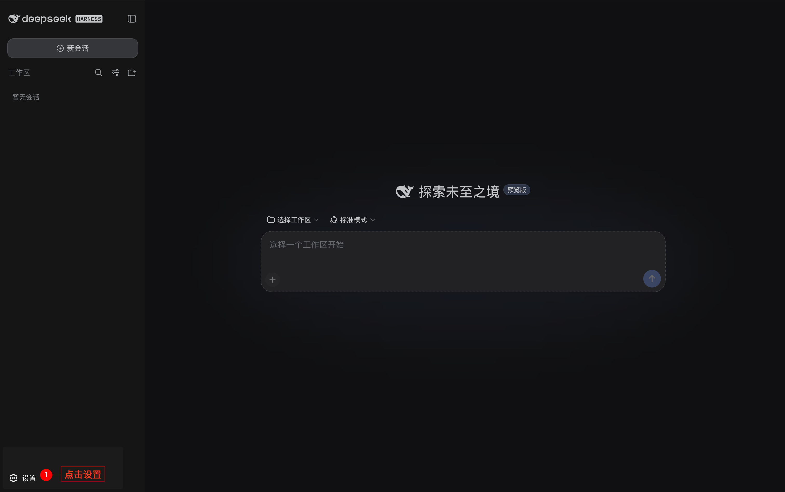
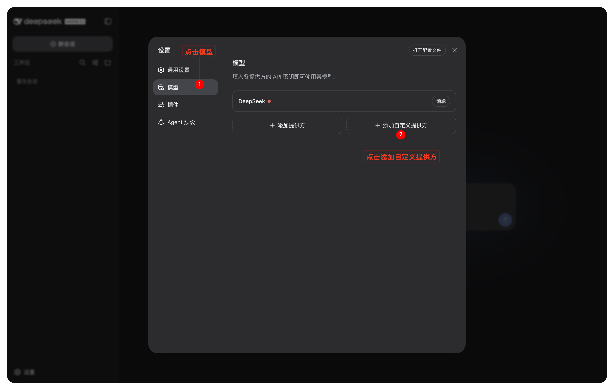
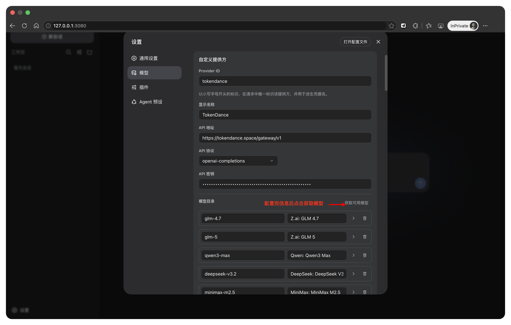
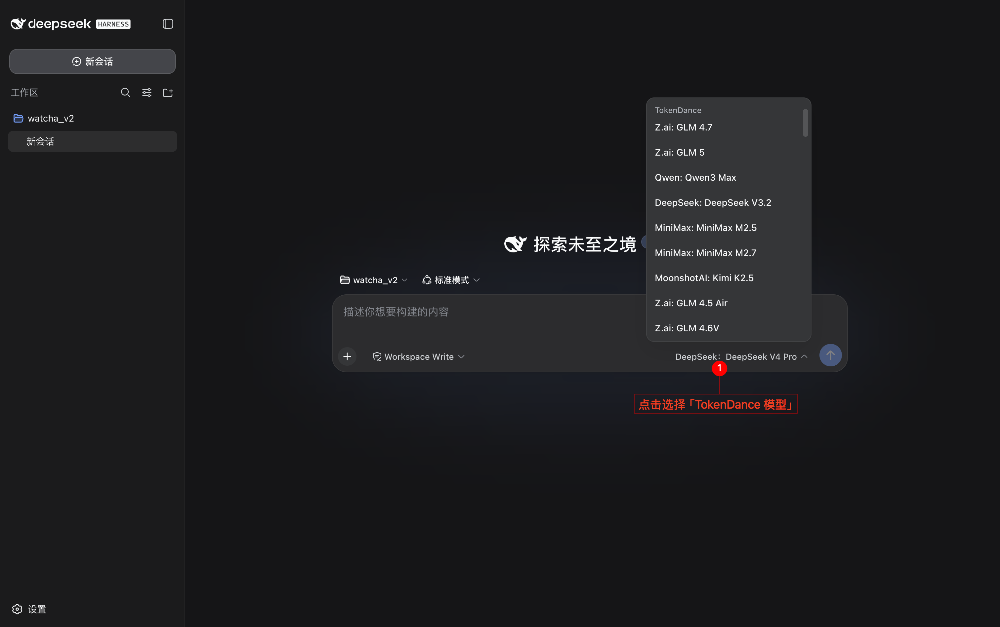

# DeepSeek Harness

[DeepSeek Harness](https://watcha.cn/products/deepseek-harness) 是一个用于构建和运行 Agent Harness 的插件化工具。将它配置到词元跳动后，你可以使用同一个词元跳动 API Key 调用支持 OpenAI Chat Completions 协议的模型，费用从词元跳动额度扣除，所有请求记录在 [调用日志](https://tokendance.space/activity) 中。

本文假设你已经启动 DeepSeek Harness Web UI。Provider 配置会在下一次请求时生效，无需重启服务。

## 准备 API Key {#prepare-api-key}

在词元跳动的 [API 密钥](https://tokendance.space/keys) 页面创建或复制一个 API Key。请勿把真实密钥提交到代码仓库、截图或公开文档中。

## 添加词元跳动 Provider {#add-provider}

1. 打开 DeepSeek Harness Web UI，进入**设置 → 模型**。

   :::images
   
   :::

2. 点击**添加自定义提供方**。

   :::images
   
   :::

3. 按下表填写配置：

| 字段 | 填写内容 |
|---|---|
| Provider ID | `tokendance` |
| 显示名称 | `TokenDance` |
| 基础 URL | `https://tokendance.space/gateway/v1` |
| API 协议 | `openai-completions` |
| API 密钥 | 你的词元跳动 API Key |

   :::images
   
   :::

::: warning
Provider ID 会被请求、已保存会话、默认模型和凭据引用使用，创建后不能直接重命名。建议首次配置时固定使用小写的 `tokendance`。
:::

## 添加并选择模型 {#add-model}

在**模型目录**中点击**获取可用模型**。DeepSeek Harness 会调用词元跳动的 `GET /models` 接口获取候选模型；选择至少一个支持 OpenAI Chat Completions 协议的模型后保存。

例如，可以添加：

- `deepseek-v4-flash-0731`
- `deepseek-v4-pro-0813`

模型会持续更新，实际可用 ID 以词元跳动 [模型列表](https://tokendance.space/models) 为准。如果自动获取失败，也可以手动输入模型 ID。

保存后，回到模型选择器，选择 `TokenDance` 下的模型并新建会话。模型切换会同时更新后续新会话的默认模型；已经发送过请求的会话仍使用创建时记录的模型。

:::images

:::

::: note
DeepSeek Harness 的自定义模型默认按纯文本模型处理。本文示例无需声明图片能力；不要仅凭模型名称为其添加未经确认的图片输入能力。
:::

## 验证接入 {#verify}

新建会话并发送一条简单请求，例如：

```text
用 Python 写一个二分查找函数，并补充 3 个边界测试。
```

收到回复后，打开词元跳动 [调用日志](https://tokendance.space/activity)，确认出现对应的模型、状态和用量记录，即表示接入成功。

## 使用配置文件接入（可选） {#settings-yaml}

如果你需要用配置文件管理 Provider，可以先在启动 DeepSeek Harness 的环境中设置密钥：

```bash
export TOKENDANCE_API_KEY="YOUR_KEY"
```

再在 `$DSH_HOME/settings.yaml` 中添加：

```yaml title="$DSH_HOME/settings.yaml"
llm-pi-ai:
  providers:
    tokendance:
      apiKeyEnv: TOKENDANCE_API_KEY
      api: openai-completions
      baseURL: https://tokendance.space/gateway/v1
      models:
        - id: deepseek-v4-flash-0731
        - id: deepseek-v4-pro-0813
```

请确保启动 Web UI 的进程能够读取 `TOKENDANCE_API_KEY`。如果使用页面录入密钥，DeepSeek Harness 会将密钥写入 `$DSH_HOME/.credentials.yaml`，设置文件只保留凭据引用，页面不会回传明文密钥。

## 常见问题 {#troubleshooting}

- **`MISSING_CREDENTIAL` / 鉴权失败**：重新在模型页保存 API Key；使用配置文件时，确认 Web UI 进程可以读取 `TOKENDANCE_API_KEY`。
- **获取可用模型返回 401**：确认填写的是有效的词元跳动 API Key，且 Base URL 为 `https://tokendance.space/gateway/v1`。
- **`UNKNOWN_MODEL` / 模型不存在**：重新获取模型列表，或确认手动输入的 ID 与词元跳动模型列表完全一致。
- **404 / 路径错误**：Base URL 需保留 `/gateway/v1`，不要填写到 `/chat/completions`。
- **模型请求不兼容**：确认所选模型支持 OpenAI Chat Completions 协议；图片、视频、语音等专用模型不能直接按本文配置调用。
- **切换模型后旧会话未变化**：这是 DeepSeek Harness 的会话模型固定机制；请新建会话后再测试。

## 相关文档 {#related}

- [DeepSeek Harness：配置模型](https://deepseek-harness.github.io/deepseek-harness/guide/providers) — 自定义 Provider 官方说明
- [OpenAI Chat Completions](../../%E6%A8%A1%E5%9E%8B%E4%B8%8E%E5%8D%8F%E8%AE%AE/%E9%80%9A%E7%94%A8%E6%A8%A1%E5%9E%8B%E5%8D%8F%E8%AE%AE/OpenAI/OpenAI%20Chat%20Completions.md) — 词元跳动 OpenAI 对话协议详情
- [API 密钥](../../%E5%BC%80%E5%A7%8B%E4%BD%BF%E7%94%A8/%E8%AE%BF%E9%97%AE%E4%B8%8E%E8%AE%A4%E8%AF%81/API%20%E5%AF%86%E9%92%A5.md) — 创建和管理密钥
- [模型](https://tokendance.space/models) — 查看当前模型及协议支持情况
