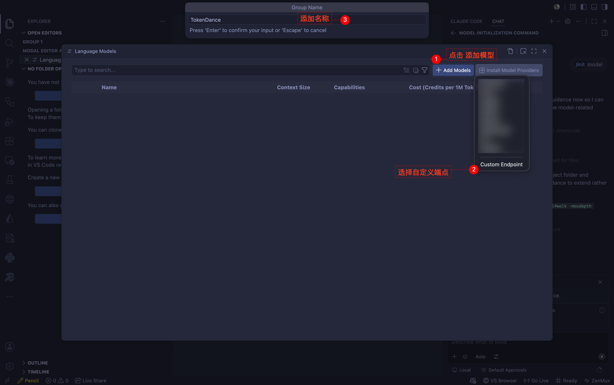
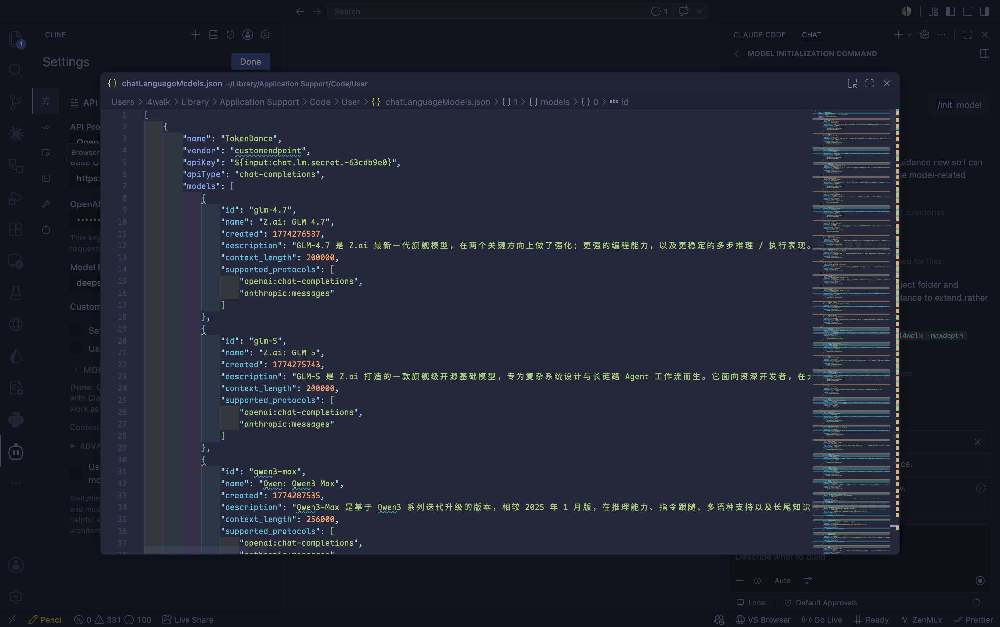
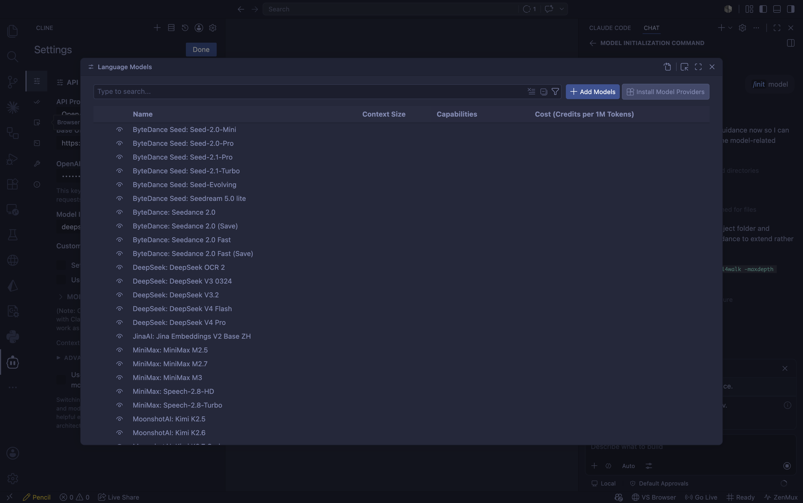

# GitHub Copilot

[GitHub Copilot](https://github.com/features/copilot) 是 GitHub 推出的 AI 编程助手，在 VS Code 中提供 BYOK（Bring Your Own Key，自带密钥）能力。通过将 GitHub Copilot 指向词元跳动，你就可以使用词元跳动上支持 OpenAI 协议的模型来驱动它，费用从词元跳动额度扣除，所有请求记录在 [调用日志](https://tokendance.space/activity) 中。

## 前提 {#prerequisites}

- VS Code 已安装 GitHub Copilot 扩展。
- BYOK 主要作用于 **Copilot Chat（对话）** 与部分辅助任务。语义检索、行内补全、嵌入等仍依赖 GitHub 账户能力。
- 若你是 Copilot Business / Enterprise 用户，需管理员在策略设置中开启「Bring Your Own Language Model Key in VS Code」。

## 配置 {#configuration}

1. 在 Chat 视图的模型选择器中点击齿轮图标 **Manage Language Models**（管理语言模型），或在命令面板运行 **Chat: Manage Language Models**。

   

2. 点击 **Add Models**（添加模型），选择一个内置供应商类型。词元跳动兼容 **OpenAI** 协议，选择 OpenAI 类供应商。
3. 按提示填写：
   - **API Key**：你的词元跳动 API Key
   - **Endpoint / Base URL**：`https://tokendance.space/gateway/v1`

   

4. 添加词元跳动上的模型 ID（如 `deepseek-v4-flash-0731`）。你也可以通过 `curl https://tokendance.space/gateway/v1/models` 获取完整模型列表，再按需添加。

   

5. 回到 Chat 的模型选择器即可选用新添加的模型。

::: note
VS Code 的内置供应商需要填写已知格式的接口地址与密钥。若你的 VS Code 为 Insiders 版本，还可使用 **Custom endpoint**（自定义端点）选项，直接指向任意兼容 Chat Completions / Messages 协议的地址。模型 ID 以词元跳动 [模型列表](https://tokendance.space/models) 中的为准。
:::

## 常见问题 {#troubleshooting}

- **模型选择器中看不到模型**：确认已在 Manage Language Models 中成功添加并保存，且模型未被隐藏（眼睛图标）。
- **鉴权失败**：检查 Base URL 为 `https://tokendance.space/gateway/v1`、密钥正确。
- **企业版无法添加**：联系管理员在 Copilot 策略设置中开启 BYOK。

## 相关文档 {#related}

- [多协议支持](../../%E6%A8%A1%E5%9E%8B%E4%B8%8E%E5%8D%8F%E8%AE%AE/%E9%80%9A%E7%94%A8%E6%A8%A1%E5%9E%8B%E5%8D%8F%E8%AE%AE/OpenAI/OpenAI%20Chat%20Completions.md) — OpenAI 协议详情
- [API 密钥](../../%E5%BC%80%E5%A7%8B%E4%BD%BF%E7%94%A8/%E8%AE%BF%E9%97%AE%E4%B8%8E%E8%AE%A4%E8%AF%81/API%20%E5%AF%86%E9%92%A5.md) — 创建和管理密钥
- [模型](https://tokendance.space/models) — 查看支持 OpenAI 协议的模型
