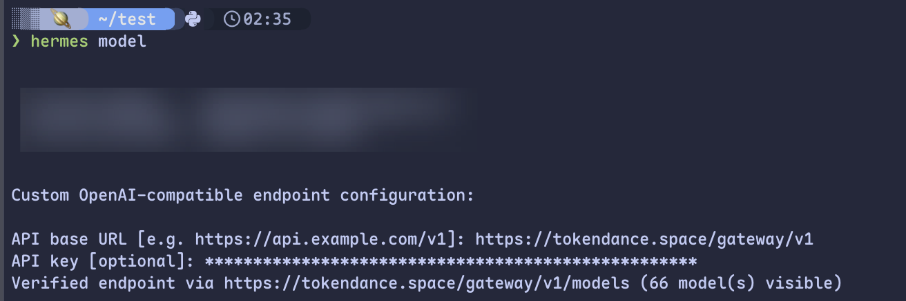

# Hermes Agent

[Hermes Agent](https://watcha.cn/products/hermes-agent?ref=tokendance-docs) 是 Nous Research 推出的自托管 AI Agent，带有自带学习循环、记忆与跨渠道能力，可运行在 VPS、GPU 集群或无服务器环境上。通过将 Hermes Agent 指向词元跳动，你就可以使用词元跳动上支持 OpenAI 协议的模型来驱动它，费用从词元跳动额度扣除，所有请求记录在 [调用日志](https://tokendance.space/activity) 中。

更多信息请访问 [观猹产品主页](https://watcha.cn/products/hermes-agent?ref=tokendance-docs)。

## 安装 Hermes Agent {#install}

:::group

```bash title="Linux / macOS / WSL2"
curl -fsSL https://hermes-agent.nousresearch.com/install.sh | bash
```

```powershell title="Windows (PowerShell)"
iex (irm https://hermes-agent.nousresearch.com/install.ps1)
```

:::

安装完成后重载 shell（`source ~/.bashrc` 或 `source ~/.zshrc`）。

## 配置 {#configuration}

Hermes 支持任意 OpenAI 兼容的自定义端点。运行模型配置命令：

```bash
hermes model
```

在交互向导中选择「自定义 / OpenAI 兼容端点（Custom / your own endpoint）」，按提示填写：



| 字段 | 填写内容 |
|---|---|
| Base URL | `https://tokendance.space/gateway/v1` |
| API Key | 你的词元跳动 API Key |
| Model | 词元跳动上的模型 ID，如 `deepseek-v4-flash-0731` |

也可以通过 `hermes config set` 写入对应配置项。配置完成后启动 `hermes` 即可对话；用 `hermes model` 可随时切换模型，无需改动代码。

::: note
Hermes 的自定义端点走 OpenAI 兼容协议。模型 ID 以词元跳动 [模型列表](https://tokendance.space/models) 中的为准，Agent 类任务建议选择能力较强、支持工具调用的模型。
:::

## 常见问题 {#troubleshooting}

- **找不到自定义端点选项**：升级到最新版本（`hermes update`），再运行 `hermes model`。
- **鉴权失败**：确认 Base URL 为 `https://tokendance.space/gateway/v1`、密钥正确。
- **运行异常**：运行 `hermes doctor` 诊断配置问题。

## 相关文档 {#related}

- [多协议支持](../../%E6%A8%A1%E5%9E%8B%E4%B8%8E%E5%8D%8F%E8%AE%AE/%E9%80%9A%E7%94%A8%E6%A8%A1%E5%9E%8B%E5%8D%8F%E8%AE%AE/OpenAI/OpenAI%20Chat%20Completions.md) — OpenAI 协议详情
- [API 密钥](../../%E5%BC%80%E5%A7%8B%E4%BD%BF%E7%94%A8/%E8%AE%BF%E9%97%AE%E4%B8%8E%E8%AE%A4%E8%AF%81/API%20%E5%AF%86%E9%92%A5.md) — 创建和管理密钥
- [模型](https://tokendance.space/models) — 查看支持 OpenAI 协议的模型
