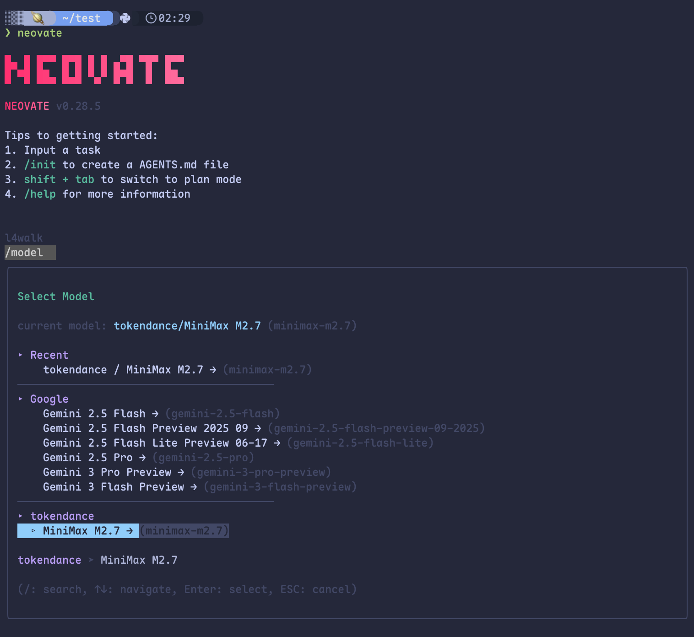

# Neovate

[Neovate Code](https://watcha.cn/products/neovate-code?ref=tokendance-docs) 是一款命令行 AI 编程 Agent，可用于生成代码、修复缺陷、审查代码、补充测试等。通过将 Neovate Code 指向词元跳动，你就可以使用词元跳动上支持 OpenAI 协议的模型来驱动它，费用从词元跳动额度扣除，所有请求记录在 [调用日志](https://tokendance.space/activity) 中。

更多信息请访问 [观猹产品主页](https://watcha.cn/products/neovate-code?ref=tokendance-docs)。

## 安装 Neovate {#install}

```bash
npm install -g @neovate/code
```

## 配置 {#configuration}

编辑 `~/.neovate/config.json`，在 `provider` 下添加词元跳动：

```json title="~/.neovate/config.json"
{
  "provider": {
    "tokendance": {
      "api": "https://tokendance.space/gateway/v1",
      "options": {
        "apiKey": "YOUR_KEY"
      },
      "models": {
        "deepseek-v4-flash-0731": {
          "name": "DeepSeek V4 Flash",
          "limit": {
            "context": 196608,
            "output": 65536
          }
        }
      },
      "apiFormat": "openai"
    }
  }
}
```

将 `YOUR_KEY` 替换为你的词元跳动 API Key，`models` 下的键替换为词元跳动上的模型 ID，`limit` 按模型实际上下文 / 输出长度填写。

配置完成后运行 `neovate`，用 `/model` 选择 `tokendance/deepseek-v4-flash-0731` 即可。



也可临时指定：

```bash
neovate -m tokendance/deepseek-v4-flash-0731 "为 @src/utils.ts 补充单元测试"
```

::: note
`apiFormat` 指定上游接口格式，可选 `openai`（默认）、`anthropic`、`responses`。词元跳动的 OpenAI 协议端点用 `openai` 即可；若想走 Anthropic 协议，把 `api` 改为 `https://tokendance.space/gateway` 并设 `apiFormat` 为 `anthropic`。模型 ID 以词元跳动 [模型列表](https://tokendance.space/models) 中的为准。
:::

## 常见问题 {#troubleshooting}

- **找不到 provider / 模型**：确认 `config.json` 格式正确，`/model` 中选择的是 `tokendance/<模型ID>`。
- **鉴权失败**：检查 `options.apiKey` 填写无误。
- **模型不存在**：`models` 的键需与词元跳动模型列表中的 ID 一致，且支持所选 `apiFormat` 对应的协议。

## 相关文档 {#related}

- [多协议支持](../../%E6%A8%A1%E5%9E%8B%E4%B8%8E%E5%8D%8F%E8%AE%AE/%E9%80%89%E6%8B%A9%E6%A8%A1%E5%9E%8B%E4%B8%8E%E5%8D%8F%E8%AE%AE/%E5%8D%8F%E8%AE%AE%E6%80%BB%E8%A7%88.md) — OpenAI / Anthropic 协议详情
- [API 密钥](../../%E5%BC%80%E5%A7%8B%E4%BD%BF%E7%94%A8/%E8%AE%BF%E9%97%AE%E4%B8%8E%E8%AE%A4%E8%AF%81/API%20%E5%AF%86%E9%92%A5.md) — 创建和管理密钥
- [模型](https://tokendance.space/models) — 查看可用模型及其支持的协议
