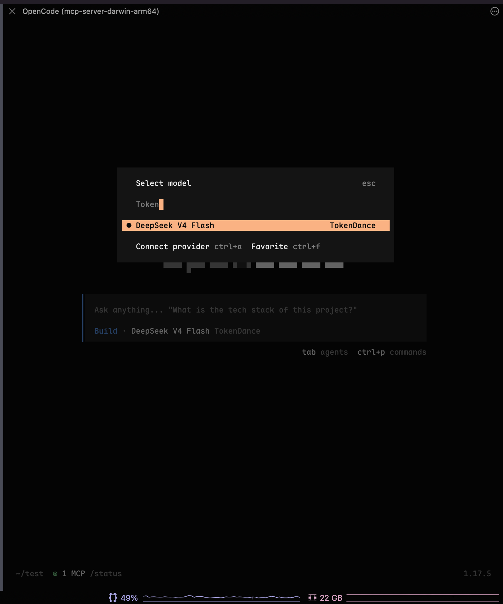

# OpenCode

[OpenCode](https://watcha.cn/products/open-code?ref=tokendance-docs) 是终端中的开源 AI 编程 Agent。通过将 OpenCode 指向词元跳动，你就可以使用词元跳动上支持 OpenAI 协议的模型来驱动它，费用从词元跳动额度扣除，所有请求记录在 [调用日志](https://tokendance.space/activity) 中。

更多信息请访问 [观猹产品主页](https://watcha.cn/products/open-code?ref=tokendance-docs)。

## 安装 OpenCode {#install}

```bash
npm install -g opencode-ai
```

## 配置 {#configuration}

在项目根目录或 `~/.config/opencode/opencode.json` 中添加词元跳动 provider：

```json title="opencode.json"
{
  "$schema": "https://opencode.ai/config.json",
  "provider": {
    "tokendance": {
      "npm": "@ai-sdk/openai-compatible",
      "name": "TokenDance",
      "options": {
        "baseURL": "https://tokendance.space/gateway/v1",
        "apiKey": "{env:TOKENDANCE_API_KEY}"
      },
      "models": {
        "deepseek-v4-flash-0731": { "name": "DeepSeek V4 Flash" }
      }
    }
  }
}
```

将 `models` 下的键替换为词元跳动上你想使用的模型 ID，并将 `YOUR_KEY` 替换为词元跳动 API Key。密钥通过环境变量注入：

```bash
export TOKENDANCE_API_KEY=YOUR_KEY
```

启动后用 `/models` 切换到 TokenDance 下的模型即可。



::: note
词元跳动的 OpenAI 协议端点命中 `/v1/chat/completions`，因此使用 `@ai-sdk/openai-compatible`。`baseURL` 填到 `/v1` 即可，SDK 会自动追加 `/chat/completions`。也可以用 `opencode auth login` 交互式录入。
:::

## 常见问题 {#troubleshooting}

- **provider 未出现**：确认 `opencode.json` 格式正确，且 `models` 下至少有一个模型项。
- **401 / 鉴权失败**：确认 `TOKENDANCE_API_KEY` 已导出到当前 shell，密钥有效。
- **模型不存在**：`models` 的键需与词元跳动 [模型列表](https://tokendance.space/models) 中的 ID 一致，且支持 OpenAI 协议。

## 相关文档 {#related}

- [多协议支持](../../%E6%A8%A1%E5%9E%8B%E4%B8%8E%E5%8D%8F%E8%AE%AE/%E9%80%9A%E7%94%A8%E6%A8%A1%E5%9E%8B%E5%8D%8F%E8%AE%AE/OpenAI/OpenAI%20Chat%20Completions.md) — OpenAI 协议详情
- [API 密钥](../../%E5%BC%80%E5%A7%8B%E4%BD%BF%E7%94%A8/%E8%AE%BF%E9%97%AE%E4%B8%8E%E8%AE%A4%E8%AF%81/API%20%E5%AF%86%E9%92%A5.md) — 创建和管理密钥
- [模型](https://tokendance.space/models) — 查看支持 OpenAI 协议的模型
